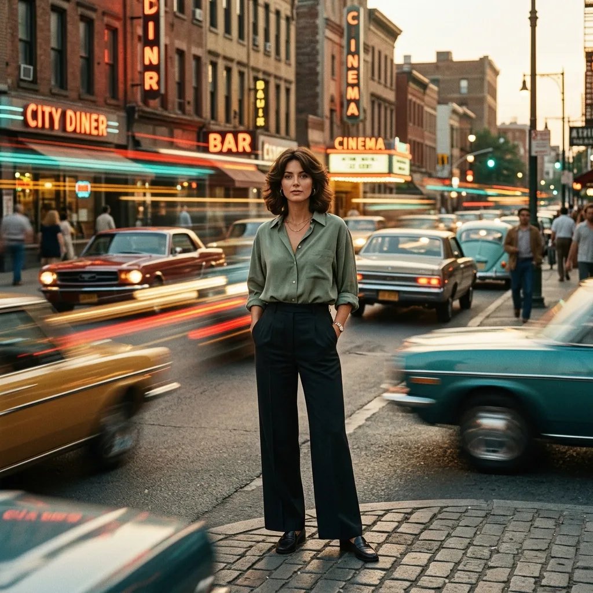

# Calm and confident

[← Back to the collection](../../README.md) · Category: [Photography](../../gallery/photography.md) · Model: `Vinano Image v2` · ID: `vn-00211`

<a href="https://vinano.ai?utm_source=github&utm_medium=readme&utm_campaign=awesome-image-video-prompts-updating&utm_content=prompt-page-image"></a>

<sub>Preview generated with <a href="https://vinano.ai?utm_source=github&utm_medium=readme&utm_campaign=awesome-image-video-prompts-updating&utm_content=prompt-page-caption">vinano.ai</a></sub>

## Prompt

```text
{
 "image_generation_prompt": {
 "subject": {
 "description": "Stylish woman",
 "expression": "calm and confident",
 "pose": "standing still, hands in pockets",
 "attire": {
 "top": "loose sage-green button-up shirt, tucked in",
 "bottom": "high-waisted dark trousers"
 }
 },
 "scene_dynamics": {
 "action": "vintage cars rushing past at high speed",
 "effect": "dramatic motion blur trails, long-exposure photography effect, dynamic motion contrast"
 },
 "environment": {
 "setting": "Street portrait",
 "atmosphere": "nostalgic, busy but focused"
 },
 "lighting_and_color": {
 "lighting": "warm golden-hour lighting",
 "color_palette": "muted retro palette",
 "accents": "reds, teals, and yellows streaking across the frame"
 },
 "technical_specifications": {
 "focus": "strong subject isolation, sharp focus on the woman, shallow depth of field",
 "style": "cinematic realism, editorial fashion mood, nostalgic 1970s film look",
 "texture": "soft grain, ultra-detailed",
 "resolution": "high resolution"
 }
 }
}

Preserve realistic proportions and depth for a confident, professional finish.
```

## Try it on vinano.ai

1. Copy the prompt above.
2. Open **[vinano.ai](https://vinano.ai?utm_source=github&utm_medium=readme&utm_campaign=awesome-image-video-prompts-updating&utm_content=prompt-page-try)**, paste it into the image generator and pick a model.
3. Swap any placeholders (brand, product, city, person…) for your own details, then generate.

More prompts like this: [Photography gallery](../../gallery/photography.md) · [all categories](../../README.md#contents)
