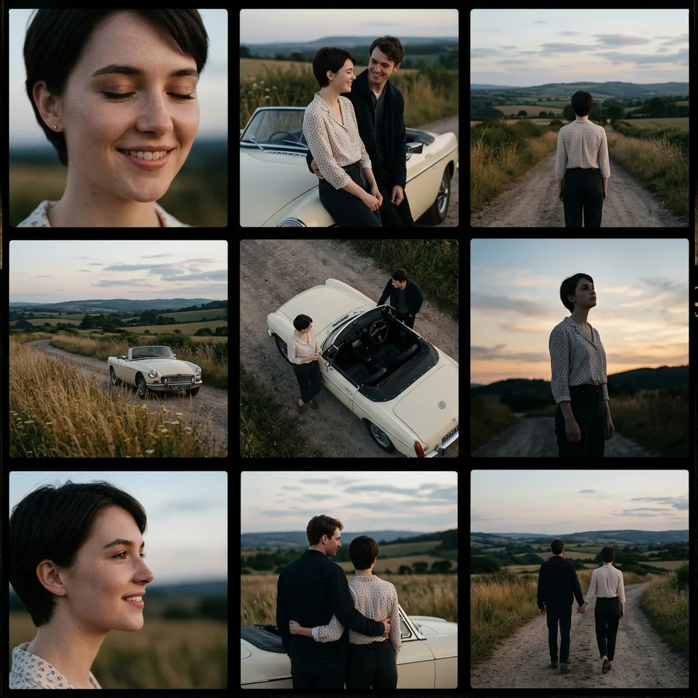

# 3×3 grid of film-still frames featuring the same couple

[← Back to the collection](../../README.md) · Category: [Photography](../../gallery/photography.md) · Model: `Vinano Image Pro` · ID: `vn-00212`

<a href="https://vinano.ai?utm_source=github&utm_medium=readme&utm_campaign=awesome-image-video-prompts-updating&utm_content=prompt-page-image"></a>

<sub>Preview generated with <a href="https://vinano.ai?utm_source=github&utm_medium=readme&utm_campaign=awesome-image-video-prompts-updating&utm_content=prompt-page-caption">vinano.ai</a></sub>

## Prompt

```text
A cinematic 3×3 grid of film-still frames featuring the same couple during a quiet countryside road stop at dusk. A young woman short dark hair wearing a light patterned blouse stands beside a cream vintage convertible on a rural dirt road, open fields and rolling hills stretching into the distance. Each frame here shows a distinct cinematic angle: extreme close-up of her face natural skin texture, intimate medium shot of the couple leaning on the car, back view of the woman facing the landscape, wide establishing shot the car in tall grass, high-angle top-down shot of the couple beside the convertible, dramatic low-angle portrait against the sky, clean side profile close-up, three-quarter rear view of the couple near the car, and a full back view of them walking away hand in hand down the road. Soft natural dusk lighting, muted earthy tones, realistic colors, shallow depth of field, subtle film grain, consistent facial features across all frames, emotional cinematic mood, professional cinematography reference sheet style, ultra-realistic photography. Emphasise material texture and natural light so the final frame feels tactile and premium.
```

## Try it on vinano.ai

1. Copy the prompt above.
2. Open **[vinano.ai](https://vinano.ai?utm_source=github&utm_medium=readme&utm_campaign=awesome-image-video-prompts-updating&utm_content=prompt-page-try)**, paste it into the image generator and pick a model.
3. Swap any placeholders (brand, product, city, person…) for your own details, then generate.

More prompts like this: [Photography gallery](../../gallery/photography.md) · [all categories](../../README.md#contents)
