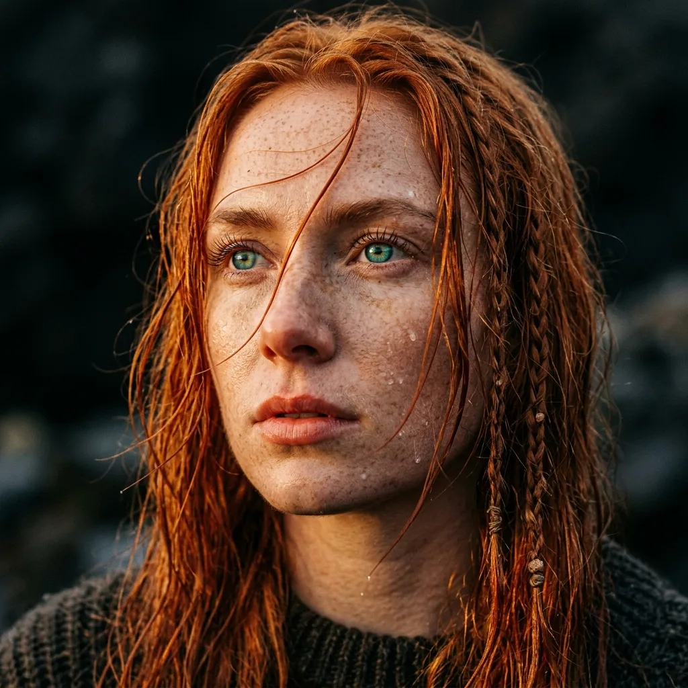

# Uploaded image as the only reference

[← Back to the collection](../../README.md) · Category: [Photography](../../gallery/photography.md) · Model: `Vinano Image v2` · ID: `vn-00216`

<a href="https://vinano.ai?utm_source=github&utm_medium=readme&utm_campaign=awesome-image-video-prompts-updating&utm_content=prompt-page-image"></a>

<sub>Preview generated with <a href="https://vinano.ai?utm_source=github&utm_medium=readme&utm_campaign=awesome-image-video-prompts-updating&utm_content=prompt-page-caption">vinano.ai</a></sub>

## Prompt

```text
the uploaded image as the only reference. create an ultra-true-to-life photorealistic cinematic close-up portrait of a young woman vivid red hair and piercing blue-green eyes. Her hair is slightly wet and blown across her face, delicate braids woven through the strands. Tiny water droplets and natural skin texture glisten across her freckles and cheeks, illuminated by warm dramatic lighting against a dark background.She looks slightly upward a calm, intense expression, capturing a moment of quiet strength. Emphasize hyper-real skin detail, freckles, wet hair strands, reflective water droplets, and luminous eyes. Shallow depth of field, dramatic contrast, moody filmic, cinematic lighting, intimate portrait composition, ultra-detailed textures, 8k photorealism. Preserve realistic proportions and depth for a confident, professional finish.
```

## Try it on vinano.ai

1. Copy the prompt above.
2. Open **[vinano.ai](https://vinano.ai?utm_source=github&utm_medium=readme&utm_campaign=awesome-image-video-prompts-updating&utm_content=prompt-page-try)**, paste it into the image generator and pick a model.
3. Swap any placeholders (brand, product, city, person…) for your own details, then generate.

More prompts like this: [Photography gallery](../../gallery/photography.md) · [all categories](../../README.md#contents)
