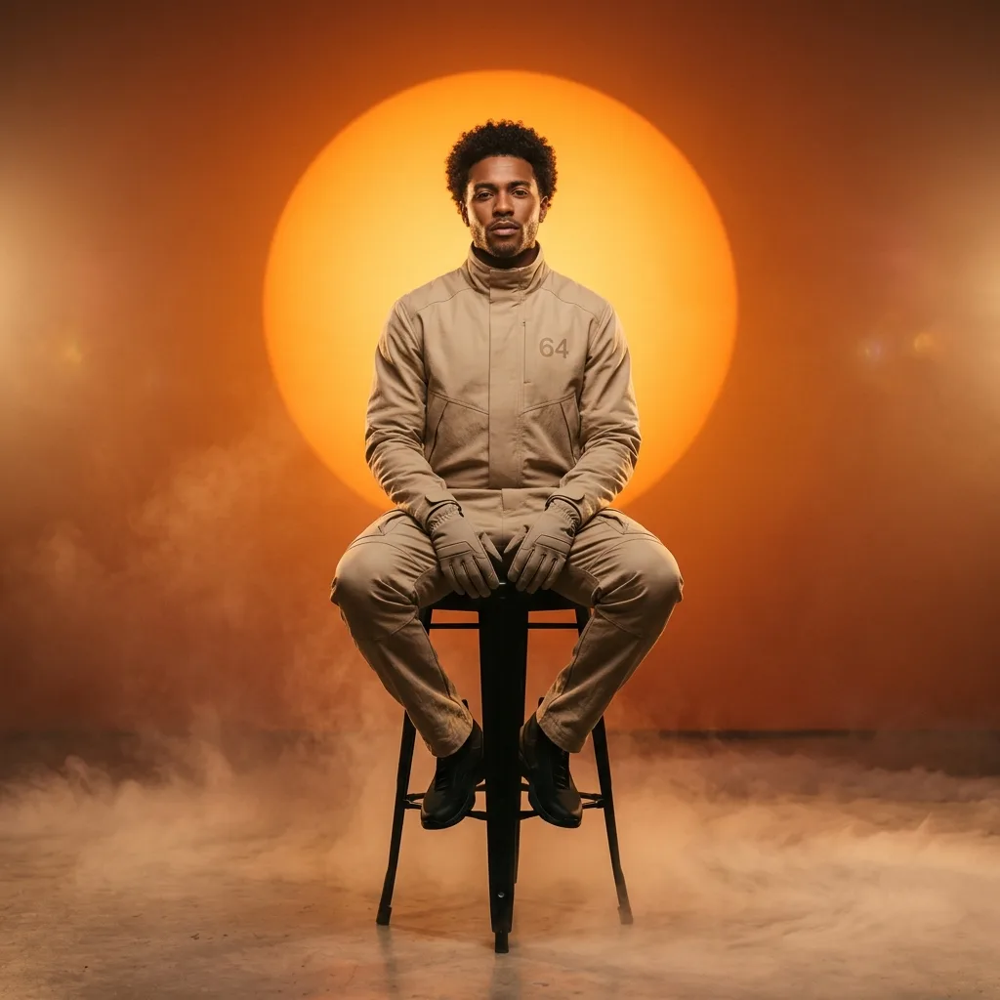

# Man short curly hair and light facial hair sitting

[← Back to the collection](../../README.md) · Category: [Photography](../../gallery/photography.md) · Model: `Vinano Image Pro` · ID: `vn-00218`

<a href="https://vinano.ai?utm_source=github&utm_medium=readme&utm_campaign=awesome-image-video-prompts-updating&utm_content=prompt-page-image"></a>

<sub>Preview generated with <a href="https://vinano.ai?utm_source=github&utm_medium=readme&utm_campaign=awesome-image-video-prompts-updating&utm_content=prompt-page-caption">vinano.ai</a></sub>

## Prompt

```text
A man short curly hair and light facial hair sitting on a tall black stool, centered composition, wearing a monochrome beige outfit gloves and the number "64" on the chest, refined minimalist futuristic fashion, dramatic studio lighting, huge glowing orange sun behind him, warm orange gradient background, cinematic atmosphere, soft fog around the floor, symmetrical framing, editorial fashion photography, ultra detailed, sharp focus, volumetric lighting, studio shot, 85mm lens, high contrast, modern album cover style Preserve realistic proportions and depth for a confident, professional finish.
```

## Try it on vinano.ai

1. Copy the prompt above.
2. Open **[vinano.ai](https://vinano.ai?utm_source=github&utm_medium=readme&utm_campaign=awesome-image-video-prompts-updating&utm_content=prompt-page-try)**, paste it into the image generator and pick a model.
3. Swap any placeholders (brand, product, city, person…) for your own details, then generate.

More prompts like this: [Photography gallery](../../gallery/photography.md) · [all categories](../../README.md#contents)
