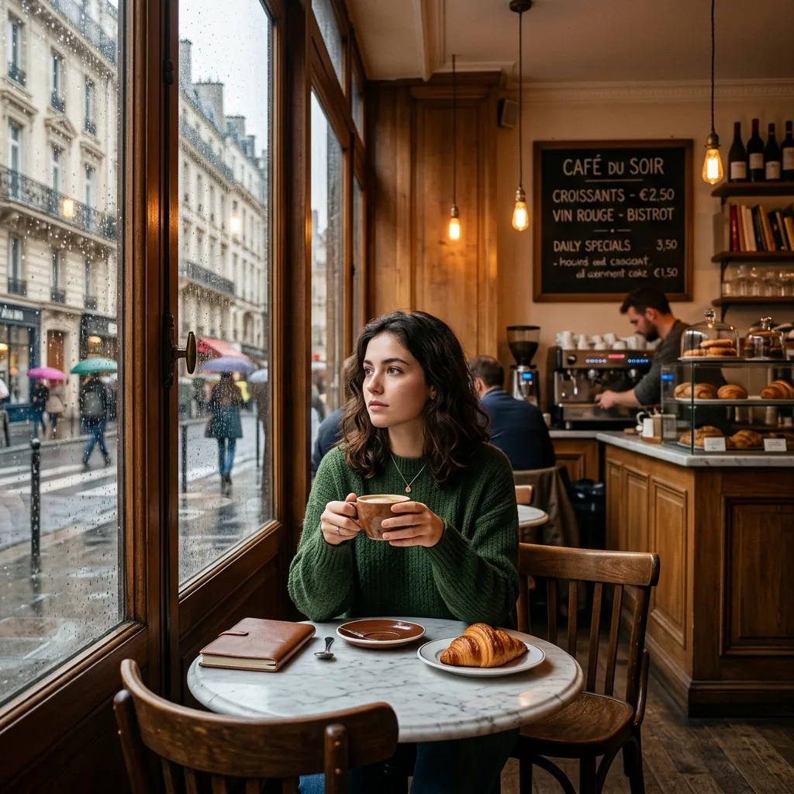

# Photo of a young woman sitting alone

[← Back to the collection](../../README.md) · Category: [Photography](../../gallery/photography.md) · Model: `Vinano Image Pro` · ID: `vn-00219`

<a href="https://vinano.ai?utm_source=github&utm_medium=readme&utm_campaign=awesome-image-video-prompts-updating&utm_content=prompt-page-image"></a>

<sub>Preview generated with <a href="https://vinano.ai?utm_source=github&utm_medium=readme&utm_campaign=awesome-image-video-prompts-updating&utm_content=prompt-page-caption">vinano.ai</a></sub>

## Prompt

```text
Cinematic photo of a young woman sitting alone in a cozy Parisian café on a rainy day, holding a cup of coffee and looking out a large window raindrops on the glass. Warm vintage café interior wooden walls, hanging Edison bulbs, marble table, croissants and coffee machine visible in the background. A chalkboard menu reading “Café du Soir, Croissants, Vin Rouge.” Soft natural window light mixed warm indoor lighting, shallow depth of field, street umbrellas and classic European buildings outside. Moody, cozy atmosphere, realistic photography, 50mm lens, high detail, cinematic color grading, lifestyle photography, ultra-realistic, 4k. Keep edges clean and the overall composition balanced for a polished, gallery-ready result.
```

## Try it on vinano.ai

1. Copy the prompt above.
2. Open **[vinano.ai](https://vinano.ai?utm_source=github&utm_medium=readme&utm_campaign=awesome-image-video-prompts-updating&utm_content=prompt-page-try)**, paste it into the image generator and pick a model.
3. Swap any placeholders (brand, product, city, person…) for your own details, then generate.

More prompts like this: [Photography gallery](../../gallery/photography.md) · [all categories](../../README.md#contents)
