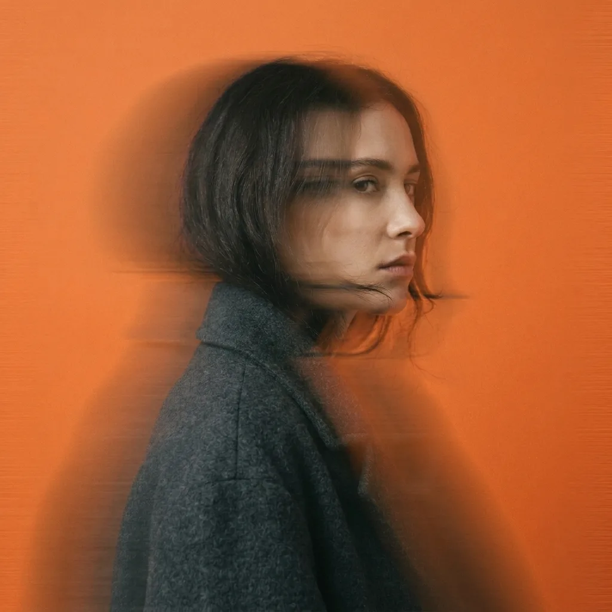

# Panning studio portrait of a mysterious female figure captured

[← Back to the collection](../../README.md) · Category: [Photography](../../gallery/photography.md) · Model: `Vinano Image v2` · ID: `vn-00220`

<a href="https://vinano.ai?utm_source=github&utm_medium=readme&utm_campaign=awesome-image-video-prompts-updating&utm_content=prompt-page-image"></a>

<sub>Preview generated with <a href="https://vinano.ai?utm_source=github&utm_medium=readme&utm_campaign=awesome-image-video-prompts-updating&utm_content=prompt-page-caption">vinano.ai</a></sub>

## Prompt

```text
A panning studio portrait of a mysterious female figure captured in side profile, her head subtly turned forward as motion blur streaks softly through her hair and jawline. She wears a matte charcoal wool coat softened edges, standing against a solid Pantone 137 C orange background that fills the frame entirely. The image features intentional horizontal motion blur from a slow shutter pan, preserving facial structure while allowing peripheral smearing. Soft studio lighting diffused highlights, low contrast, and lifted blacks creates a faded analog film look fine grain and muted saturation. Shot on a full-frame camera a 50mm lens at f/2.8, ISO 200, shutter speed 1/15s, vertical orientation, tight portrait framing, shallow depth of field. The mood is cinematic, introspective, and modern editorial visual language aligned 032c and A24 aesthetics. Emphasise material texture and natural light so the final frame feels tactile and premium.
```

## Try it on vinano.ai

1. Copy the prompt above.
2. Open **[vinano.ai](https://vinano.ai?utm_source=github&utm_medium=readme&utm_campaign=awesome-image-video-prompts-updating&utm_content=prompt-page-try)**, paste it into the image generator and pick a model.
3. Swap any placeholders (brand, product, city, person…) for your own details, then generate.

More prompts like this: [Photography gallery](../../gallery/photography.md) · [all categories](../../README.md#contents)
