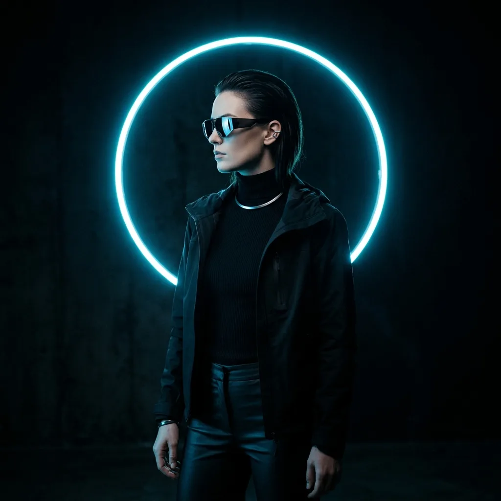

# Captured in a dark studio environment a strong refined

[← Back to the collection](../../README.md) · Category: [Photography](../../gallery/photography.md) · Model: `Vinano Image v2` · ID: `vn-00221`

<a href="https://vinano.ai?utm_source=github&utm_medium=readme&utm_campaign=awesome-image-video-prompts-updating&utm_content=prompt-page-image"></a>

<sub>Preview generated with <a href="https://vinano.ai?utm_source=github&utm_medium=readme&utm_campaign=awesome-image-video-prompts-updating&utm_content=prompt-page-caption">vinano.ai</a></sub>

## Prompt

```text
captured in a dark studio environment a strong refined minimalist and futuristic aesthetic. The subject is posed in three-quarter profile, wearing dark clothing such as a black turtleneck and metallic accessories, reflective sunglasses that catch the ambient light. A circular neon light positioned directly behind the subject creates a luminous halo effect, producing precise rim highlights along the head and shoulders. The lighting is cool and monochromatic, primarily in icy blue tones (-6500K), casting subtle reflections and soft gradients across the matte tex-tures. The background is a deep black (approx. HEX #020509), allowing the neon ring's cyan glow (approx. Maintain consistent colour harmony and crisp focus across the whole frame.
```

## Try it on vinano.ai

1. Copy the prompt above.
2. Open **[vinano.ai](https://vinano.ai?utm_source=github&utm_medium=readme&utm_campaign=awesome-image-video-prompts-updating&utm_content=prompt-page-try)**, paste it into the image generator and pick a model.
3. Swap any placeholders (brand, product, city, person…) for your own details, then generate.

More prompts like this: [Photography gallery](../../gallery/photography.md) · [all categories](../../README.md#contents)
