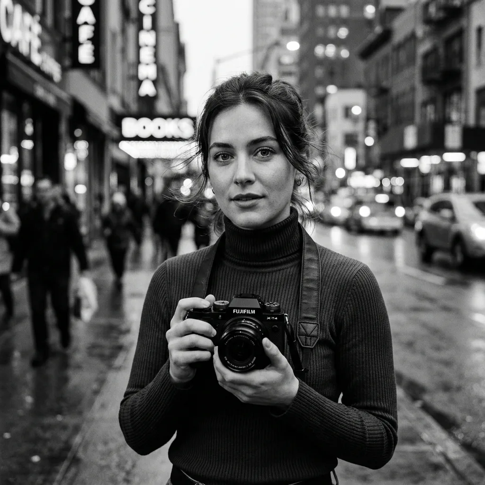

# Black-and-white street portrait of a young woman photographer standing

[← Back to the collection](../../README.md) · Category: [Photography](../../gallery/photography.md) · Model: `Vinano Image v2` · ID: `vn-00223`

<a href="https://vinano.ai?utm_source=github&utm_medium=readme&utm_campaign=awesome-image-video-prompts-updating&utm_content=prompt-page-image"></a>

<sub>Preview generated with <a href="https://vinano.ai?utm_source=github&utm_medium=readme&utm_campaign=awesome-image-video-prompts-updating&utm_content=prompt-page-caption">vinano.ai</a></sub>

## Prompt

```text
A cinematic black-and-white street portrait of a young woman photographer standing in a city street, holding a mirrorless camera both hands. She has soft natural makeup, sharp expressive eyes, and loosely tied dark hair wisps framing her face. She wears a black turtleneck sweater and a camera strap around her neck. The background is an urban street blurred pedestrians and lights creating creamy bokeh. Shallow depth of field, 85mm lens look, natural soft light, high contrast monochrome tones, realistic skin texture, candid moment, moody documentary photography style, ultra-detailed, film grain, timeless aesthetic. Preserve realistic proportions and depth for a confident, professional finish.
```

## Try it on vinano.ai

1. Copy the prompt above.
2. Open **[vinano.ai](https://vinano.ai?utm_source=github&utm_medium=readme&utm_campaign=awesome-image-video-prompts-updating&utm_content=prompt-page-try)**, paste it into the image generator and pick a model.
3. Swap any placeholders (brand, product, city, person…) for your own details, then generate.

More prompts like this: [Photography gallery](../../gallery/photography.md) · [all categories](../../README.md#contents)
