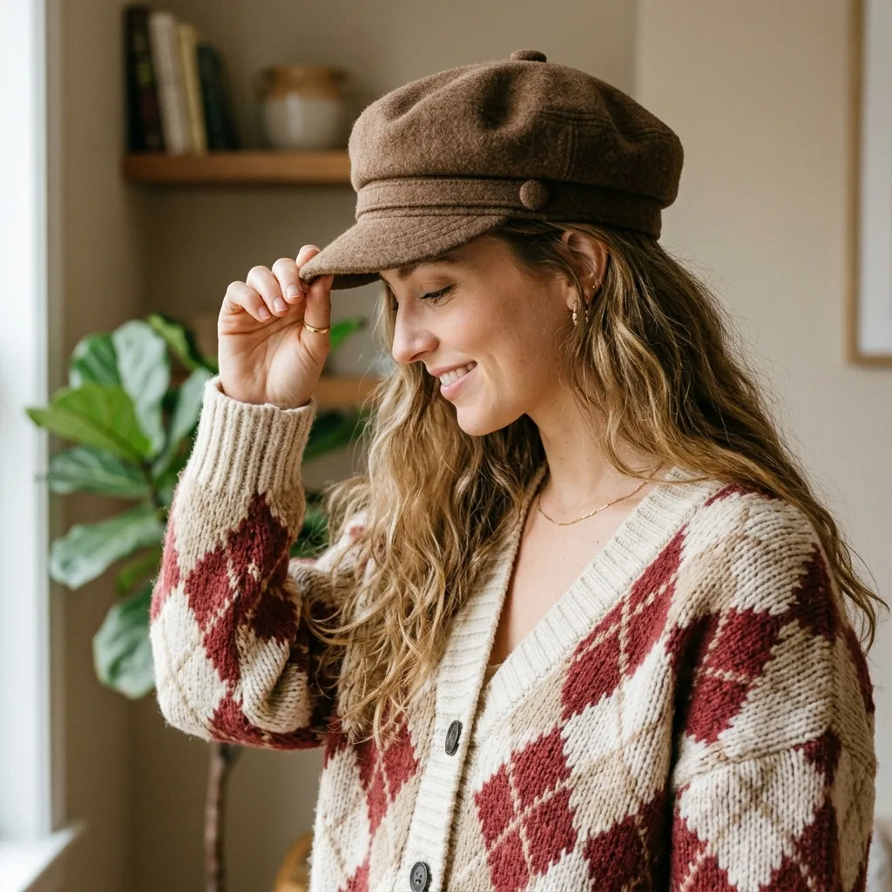

# Warm, cozy, and premium-quality portrait of a young woman

[← Back to the collection](../../README.md) · Category: [Photography](../../gallery/photography.md) · Model: `Vinano Image v2` · ID: `vn-00225`

<a href="https://vinano.ai?utm_source=github&utm_medium=readme&utm_campaign=awesome-image-video-prompts-updating&utm_content=prompt-page-image"></a>

<sub>Preview generated with <a href="https://vinano.ai?utm_source=github&utm_medium=readme&utm_campaign=awesome-image-video-prompts-updating&utm_content=prompt-page-caption">vinano.ai</a></sub>

## Prompt

```text
A warm, cozy, and premium-quality portrait of a young woman long, wavy blonde-brown hair, captured in a soft side profile. She is smiling gently and looking downward, her left hand delicately adjusting the brim of a classic brown wool baker boy cap. The cap features a thick, felted texture a small button nub on top. She is wearing an oversized, chunky knit V-neck cardigan a bold argyle-style diamond pattern in cream and a muted, deep red. The cardigan features large, visible buttons and a thick ribbed texture along the neckline and cuffs. The background is a soft-focus, neutral beige wall the blurred green leaves of a plant visible on the far left edge. The lighting is soft and natural, coming from the side to highlight the delicate features of her face and the intricate textures of the knitwear and wool hat. The overall aesthetic is autumnal, serene, and tactile. Render with rich micro-detail while keeping the layout uncluttered and intentional.
```

## Try it on vinano.ai

1. Copy the prompt above.
2. Open **[vinano.ai](https://vinano.ai?utm_source=github&utm_medium=readme&utm_campaign=awesome-image-video-prompts-updating&utm_content=prompt-page-try)**, paste it into the image generator and pick a model.
3. Swap any placeholders (brand, product, city, person…) for your own details, then generate.

More prompts like this: [Photography gallery](../../gallery/photography.md) · [all categories](../../README.md#contents)
