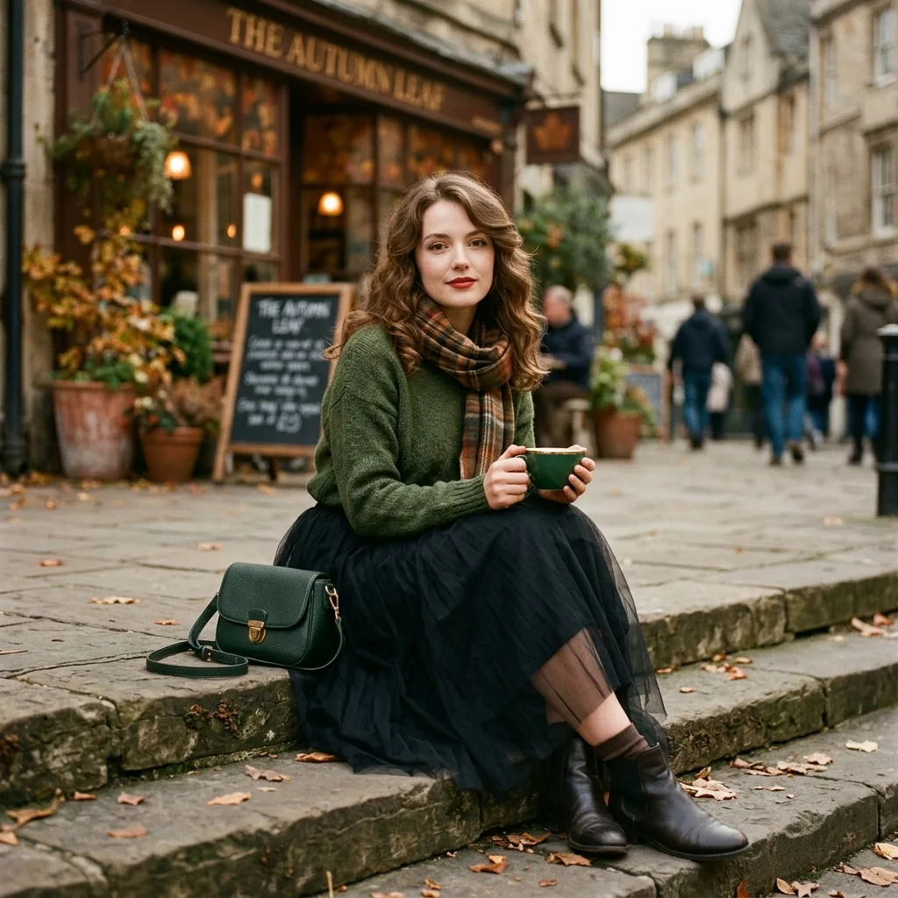

# 1970s-inspired fashion portrait of a young woman seated

[← Back to the collection](../../README.md) · Category: [Photography](../../gallery/photography.md) · Model: `Vinano Image v2` · ID: `vn-00231`

<a href="https://vinano.ai?utm_source=github&utm_medium=readme&utm_campaign=awesome-image-video-prompts-updating&utm_content=prompt-page-image"></a>

<sub>Preview generated with <a href="https://vinano.ai?utm_source=github&utm_medium=readme&utm_campaign=awesome-image-video-prompts-updating&utm_content=prompt-page-caption">vinano.ai</a></sub>

## Prompt

```text
A cinematic 1970s-inspired fashion portrait of a young woman seated on worn stone steps outside a cozy street café. She holds a deep-green ceramic coffee cup gold rim accents, resting it gently in her hands, gazing softly at the camera calm, timeless confidence.

Her hair falls in natural waves loose strands framing her face, styled vintage 1970s elegance. Makeup is classic: matte crimson lips, subtle winged eyeliner, warm blush, and softly defined brows. She wears a relaxed forest-green knitted sweater paired a flowing black tulle skirt, complemented by a warm plaid scarf in earthy tones. A dark-green leather crossbody bag gold details sits beside her.

The background shows an autumn street scene fallen leaves, amber-lit café windows, and a quiet, serene urban atmosphere. Shot an 85mm lens at f/1.8, the image features shallow depth of field, warm analog film grain, muted earthy colors, and a dreamy, cinematic fashion editorial feel inspired by 1970s film aesthetics.

Emphasise material texture and natural light so the final frame feels tactile and premium.
```

## Try it on vinano.ai

1. Copy the prompt above.
2. Open **[vinano.ai](https://vinano.ai?utm_source=github&utm_medium=readme&utm_campaign=awesome-image-video-prompts-updating&utm_content=prompt-page-try)**, paste it into the image generator and pick a model.
3. Swap any placeholders (brand, product, city, person…) for your own details, then generate.

More prompts like this: [Photography gallery](../../gallery/photography.md) · [all categories](../../README.md#contents)
