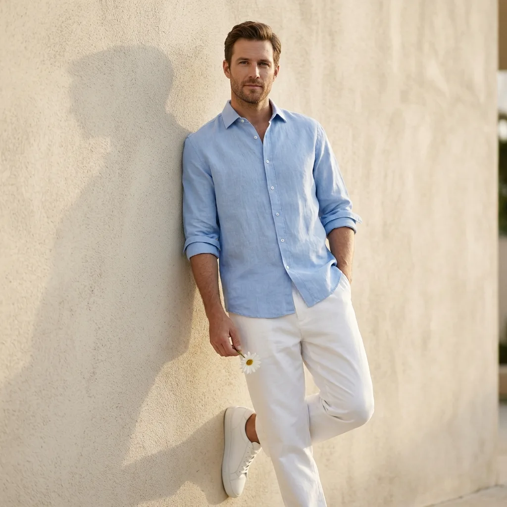

# Uploaded reference image of a 30-year-old adult, generate

[← Back to the collection](../../README.md) · Category: [Photography](../../gallery/photography.md) · Model: `Vinano Image Pro` · ID: `vn-00236`

<a href="https://vinano.ai?utm_source=github&utm_medium=readme&utm_campaign=awesome-image-video-prompts-updating&utm_content=prompt-page-image"></a>

<sub>Preview generated with <a href="https://vinano.ai?utm_source=github&utm_medium=readme&utm_campaign=awesome-image-video-prompts-updating&utm_content=prompt-page-caption">vinano.ai</a></sub>

## Prompt

```text
{
 "prompt": " the uploaded reference image of a 30-year-old adult, generate a highly realistic cinematic fashion editorial photoshoot. The person is leaning casually against a beige textured wall, body slightly angled, one shoulder resting on the wall, conveying relaxed confidence.\n\nOutfit: a loose pastel blue button-down shirt casually rolled-up sleeves, tailored white relaxed-fit trousers, and clean refined minimalist white or blue-white sneakers. Styling is modern, elegant, and effortless.\n\nPose & expression: stylish adult pose natural posture — one hand in pocket, the other holding a small white daisy flower. Facial expression is calm, confident, and self-assured, a soft editorial gaze.\n\nLighting & atmosphere: warm natural sunlight streaming from the side, creating soft highlights and gentle shadows on the wall and face. Sunlit, airy mood cinematic depth.\n\nVisual style: high-end fashion editorial aesthetic, natural skin texture, crisp fabric details, refined neutral color palette.\n\nCamera & quality: professional fashion photography, shallow depth of field, cinematic framing, ultra-realistic 8K quality.\n\nOverall feel: modern, minimal, sunlit lifestyle fashion campaign.",
 "style": "cinematic, high-end adult fashion editorial",
 "lighting": "warm natural sunlight, soft shadows",
 "background": "minimal beige wall, sunlit texture",
 "quality": "ultra-realistic, 8K, ultra-sharp",
 "camera": "professional fashion photography, shallow depth of field",
 "mood": "clean, modern, confident, relaxed"
}

Emphasise material texture and natural light so the final frame feels tactile and premium.
```

## Try it on vinano.ai

1. Copy the prompt above.
2. Open **[vinano.ai](https://vinano.ai?utm_source=github&utm_medium=readme&utm_campaign=awesome-image-video-prompts-updating&utm_content=prompt-page-try)**, paste it into the image generator and pick a model.
3. Swap any placeholders (brand, product, city, person…) for your own details, then generate.

More prompts like this: [Photography gallery](../../gallery/photography.md) · [all categories](../../README.md#contents)
