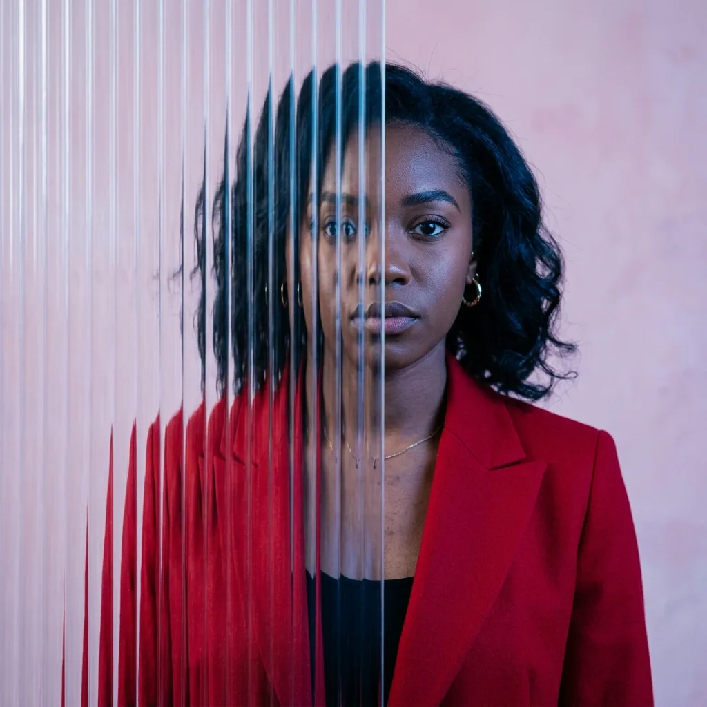

# Striking editorial portrait photograph of a person wearing

[← Back to the collection](../../README.md) · Category: [Photography](../../gallery/photography.md) · Model: `Vinano Image Pro` · ID: `vn-00240`

<a href="https://vinano.ai?utm_source=github&utm_medium=readme&utm_campaign=awesome-image-video-prompts-updating&utm_content=prompt-page-image"></a>

<sub>Preview generated with <a href="https://vinano.ai?utm_source=github&utm_medium=readme&utm_campaign=awesome-image-video-prompts-updating&utm_content=prompt-page-caption">vinano.ai</a></sub>

## Prompt

```text
A striking editorial portrait photograph of a person wearing a red blazer, shot against a soft light pink studio background. The left half of the face and body is partially obscured by multiple overlapping vertical strips of tall narrow reeded ribbed frosted glass panels, creating a realistic distortion and refraction effect where the features appear blurred, shifted, and fragmented behind the glass. The right side of the face is clearly visible sharp detail. Dramatic cool-toned studio lighting a blue-purple color grade overall. The glass strips run vertically from top to bottom of the frame, covering approximately the left 40 to 50 percent of the image. Serious neutral facial expression. High-fashion editorial style, true-to-life photorealistic, no text, no watermark, no overlays, crisp composition. Vertical portrait orientation, 3:4 ratio. Preserve realistic proportions and depth for a confident, professional finish.
```

## Try it on vinano.ai

1. Copy the prompt above.
2. Open **[vinano.ai](https://vinano.ai?utm_source=github&utm_medium=readme&utm_campaign=awesome-image-video-prompts-updating&utm_content=prompt-page-try)**, paste it into the image generator and pick a model.
3. Swap any placeholders (brand, product, city, person…) for your own details, then generate.

More prompts like this: [Photography gallery](../../gallery/photography.md) · [all categories](../../README.md#contents)
