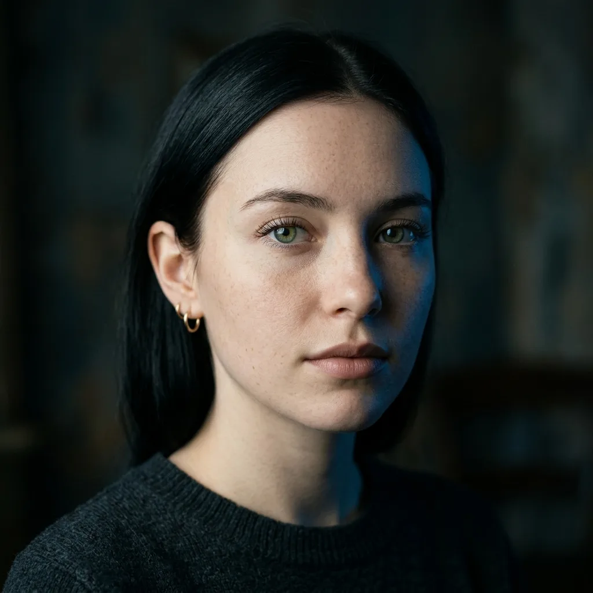

# Close-up portrait of a young woman fair skin

[← Back to the collection](../../README.md) · Category: [Photography](../../gallery/photography.md) · Model: `Vinano Image v2` · ID: `vn-00242`

<a href="https://vinano.ai?utm_source=github&utm_medium=readme&utm_campaign=awesome-image-video-prompts-updating&utm_content=prompt-page-image"></a>

<sub>Preview generated with <a href="https://vinano.ai?utm_source=github&utm_medium=readme&utm_campaign=awesome-image-video-prompts-updating&utm_content=prompt-page-caption">vinano.ai</a></sub>

## Prompt

```text
Ultra-realistic close-up portrait of a young woman fair skin and subtle freckles, green eyes, and natural full lips, dark straight hair tucked behind the ear, wearing small gold hoop earrings. Dramatic split lighting across the face — one half illuminated soft natural light, the other half in deep shadow cool blue tones. High detail skin texture, sharp focus on eyes and eyelashes, minimal makeup, filmic, cinematic lighting, moody atmosphere, shallow depth of field, 85mm lens, f/1.8, true-to-life photorealistic, editorial beauty photography. Render with rich micro-detail while keeping the layout uncluttered and intentional.
```

## Try it on vinano.ai

1. Copy the prompt above.
2. Open **[vinano.ai](https://vinano.ai?utm_source=github&utm_medium=readme&utm_campaign=awesome-image-video-prompts-updating&utm_content=prompt-page-try)**, paste it into the image generator and pick a model.
3. Swap any placeholders (brand, product, city, person…) for your own details, then generate.

More prompts like this: [Photography gallery](../../gallery/photography.md) · [all categories](../../README.md#contents)
