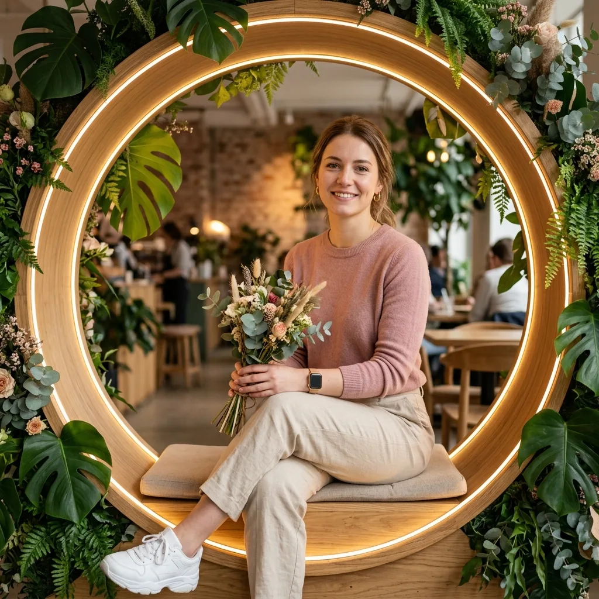

# High-end lifestyle portrait of one adult subject, captured

[← Back to the collection](../../README.md) · Category: [Photography](../../gallery/photography.md) · Model: `Vinano Image v2` · ID: `vn-00243`

<a href="https://vinano.ai?utm_source=github&utm_medium=readme&utm_campaign=awesome-image-video-prompts-updating&utm_content=prompt-page-image"></a>

<sub>Preview generated with <a href="https://vinano.ai?utm_source=github&utm_medium=readme&utm_campaign=awesome-image-video-prompts-updating&utm_content=prompt-page-caption">vinano.ai</a></sub>

## Prompt

```text
Create an ultra-realistic, high-end lifestyle portrait of one adult subject, captured in a calm, elegant, modern café environment. The subject is seated casually inside a circular wooden frame embedded warm LED rim lighting, surrounded by lush green foliage and soft floral decor. The pose is relaxed and natural: one leg crossed over the other, body slightly angled, shoulders relaxed, hands resting naturally while holding a small bouquet of fresh flowers. Overall mood is warm, clean, elegant, youthful, and approachable — pure realism only. No stylization, no fantasy, no cinematic exaggeration.

Maintain 100% facial accuracy: exact bone structure, eye shape, eyelid fold, eyebrow shape, nose bridge and tip, lip shape, jawline, chin, cheek volume, hairline, and facial proportions

Identity must remain perfectly consistent from all angles (front, 3/4, side, seated pose, slight head tilt)

No face blending, no beautification, no symmetry correction

No AI face drift

Preserve real skin texture: pores, fine lines, natural imperfections

Expression: soft, natural smile, relaxed and genuine

Soft pastel long-sleeve knit top (dusty pink / muted rose tone)

High-waisted, straight-fit beige or cream trousers

Clean white chunky sneakers

Minimal accessories only (simple earrings, smartwatch or minimal wrist accessory)

Hair neatly styled, natural, pulled back or softly tied

Natural makeup: realistic skin tones, no heavy retouching

Modern café or lifestyle studio interior

Circular wooden structure embedded warm LED light ring

Green plants and floral arrangements integrated into the frame

Soft bokeh background warm ambient lighting

Clean, uncluttered setting depth and realism

Full-body or 3/4 body vertical portrait

Eye-level camera angle

50mm–85mm lens look

Natural perspective, no distortion

Subject centered within the circular frame

Shallow depth of field, background softly blurred

Soft, warm, diffused lighting

LED rim light gently outlining the circular frame

Even facial illumination natural shadow falloff

No harsh highlights, no blown whites

Realistic skin reflections and depth

Negative prompt:

No stylization

No cinematic color grading

No beauty filters

No smooth or plastic skin

No exaggerated proportions

No painterly or illustrated look

No artificial glow

No face morphing or identity shift

Ultra-true-to-life photorealistic

Editorial lifestyle photography quality

Natural colors, true-to-life skin tones

Identity remains unchanged and accurate from every angle

Emphasise material texture and natural light so the final frame feels tactile and premium.
```

## Try it on vinano.ai

1. Copy the prompt above.
2. Open **[vinano.ai](https://vinano.ai?utm_source=github&utm_medium=readme&utm_campaign=awesome-image-video-prompts-updating&utm_content=prompt-page-try)**, paste it into the image generator and pick a model.
3. Swap any placeholders (brand, product, city, person…) for your own details, then generate.

More prompts like this: [Photography gallery](../../gallery/photography.md) · [all categories](../../README.md#contents)
