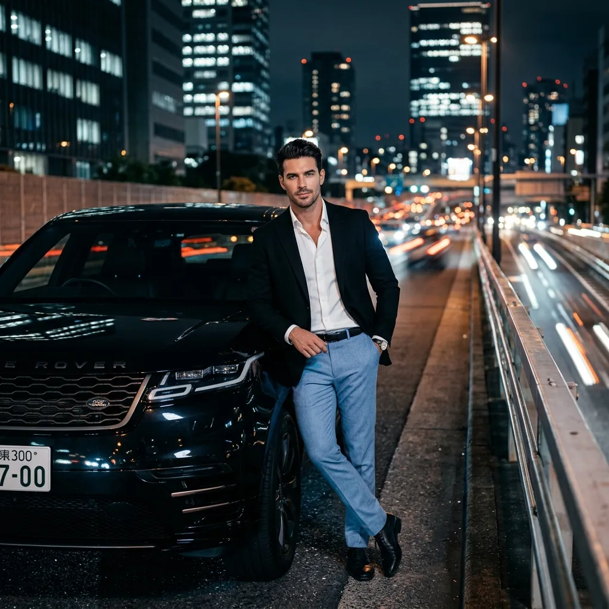

# Night-time urban portrait of a confident, handsome man leaning

[← Back to the collection](../../README.md) · Category: [Photography](../../gallery/photography.md) · Model: `Vinano Image v2` · ID: `vn-00246`

<a href="https://vinano.ai?utm_source=github&utm_medium=readme&utm_campaign=awesome-image-video-prompts-updating&utm_content=prompt-page-image"></a>

<sub>Preview generated with <a href="https://vinano.ai?utm_source=github&utm_medium=readme&utm_campaign=awesome-image-video-prompts-updating&utm_content=prompt-page-caption">vinano.ai</a></sub>

## Prompt

```text
A cinematic night-time urban portrait of a confident, handsome man leaning against a black luxury SUV on a modern city highway. He is wearing a black blazer over a white unbuttoned dress shirt and light blue tailored trousers, one hand in his pocket, the other resting on the car. Clean haircut, light stubble, sharp masculine features. Skyscrapers glowing windows in the background, streetlights creating bokeh, long light trails from passing traffic. Moody, high-contrast lighting, shallow depth of field, professional fashion photography, ultra-realistic, 85mm lens, f/1.8, cinematic color grading, luxury lifestyle aesthetic. Keep edges clean and the overall composition balanced for a polished, gallery-ready result.
```

## Try it on vinano.ai

1. Copy the prompt above.
2. Open **[vinano.ai](https://vinano.ai?utm_source=github&utm_medium=readme&utm_campaign=awesome-image-video-prompts-updating&utm_content=prompt-page-try)**, paste it into the image generator and pick a model.
3. Swap any placeholders (brand, product, city, person…) for your own details, then generate.

More prompts like this: [Photography gallery](../../gallery/photography.md) · [all categories](../../README.md#contents)
