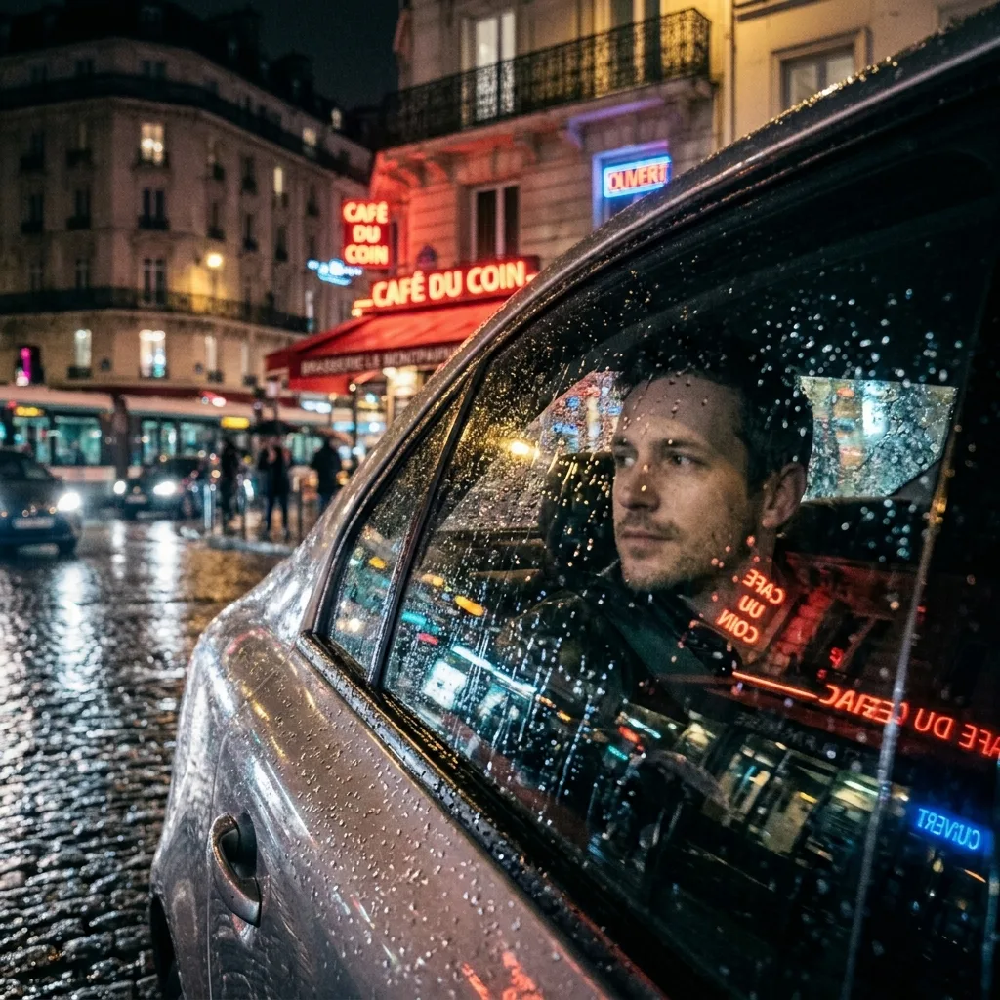

# Low-angle, cinematic close-up shot looking through a rain-slicked car

[← Back to the collection](../../README.md) · Category: [Photography](../../gallery/photography.md) · Model: `Vinano Image v2` · ID: `vn-00249`

<a href="https://vinano.ai?utm_source=github&utm_medium=readme&utm_campaign=awesome-image-video-prompts-updating&utm_content=prompt-page-image"></a>

<sub>Preview generated with <a href="https://vinano.ai?utm_source=github&utm_medium=readme&utm_campaign=awesome-image-video-prompts-updating&utm_content=prompt-page-caption">vinano.ai</a></sub>

## Prompt

```text
A low-angle, cinematic close-up shot looking through a rain-slicked car window. Inside the car, a contemplative man short dark hair and slight stubble is visible, looking out toward the city. The focus is sharp on the water droplets clinging to the glass, while the man and the background are slightly softer.
​Setting & Atmosphere: A bustling European city street at night during a rainstorm. The atmosphere is melancholic yet cozy. In the reflection of the car door and window, blurred city lights, glowing neon shop signs (blues and reds), and the outlines of historical architecture are visible.
​Lighting & Color: * Lighting: Naturalistic night lighting provided by street lamps and neon signs, creating a cool blue and teal base warm orange and red highlights.
​Reflections: Complex reflections of wet pavement and passing cars on the dark metallic surface of the vehicle.
​Technical Specs: 35mm lens, f/1.8 aperture for shallow depth of field, high contrast, moody film grain, hyper-realistic textures, shot on Sony A7R IV style.

Preserve realistic proportions and depth for a confident, professional finish.
```

## Try it on vinano.ai

1. Copy the prompt above.
2. Open **[vinano.ai](https://vinano.ai?utm_source=github&utm_medium=readme&utm_campaign=awesome-image-video-prompts-updating&utm_content=prompt-page-try)**, paste it into the image generator and pick a model.
3. Swap any placeholders (brand, product, city, person…) for your own details, then generate.

More prompts like this: [Photography gallery](../../gallery/photography.md) · [all categories](../../README.md#contents)
