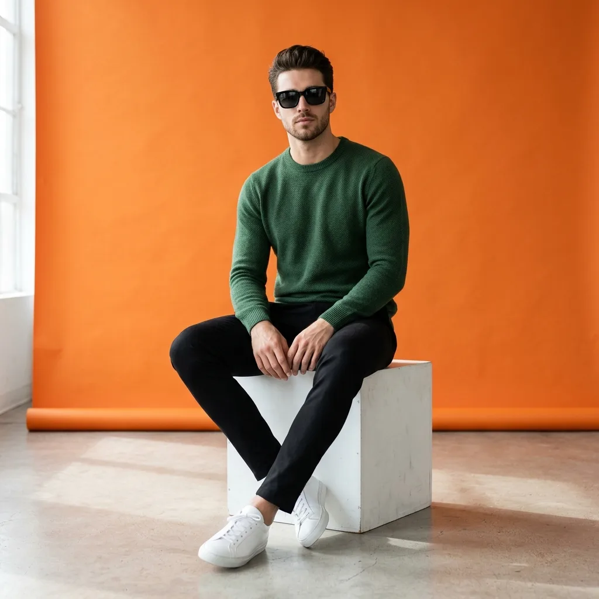

# Stylish male model sitting on a white cube

[← Back to the collection](../../README.md) · Category: [Photography](../../gallery/photography.md) · Model: `Vinano Image v2` · ID: `vn-00255`

<a href="https://vinano.ai?utm_source=github&utm_medium=readme&utm_campaign=awesome-image-video-prompts-updating&utm_content=prompt-page-image"></a>

<sub>Preview generated with <a href="https://vinano.ai?utm_source=github&utm_medium=readme&utm_campaign=awesome-image-video-prompts-updating&utm_content=prompt-page-caption">vinano.ai</a></sub>

## Prompt

```text
A stylish male model sitting on a white cube in a refined minimalist studio a vibrant orange background. He is wearing a fitted green knit sweater, black pants, and white sneakers, paired black sunglasses for a modern, confident look. The model sits relaxed hands resting together, facing the camera. Soft directional lighting creates subtle shadows on the floor and background, adding depth and a premium fashion editorial feel. crisp composition, centered framing, smooth backdrop, high contrast colors, sharp details, professional studio photography, ultra-realistic, 8K. Preserve realistic proportions and depth for a confident, professional finish.
```

## Try it on vinano.ai

1. Copy the prompt above.
2. Open **[vinano.ai](https://vinano.ai?utm_source=github&utm_medium=readme&utm_campaign=awesome-image-video-prompts-updating&utm_content=prompt-page-try)**, paste it into the image generator and pick a model.
3. Swap any placeholders (brand, product, city, person…) for your own details, then generate.

More prompts like this: [Photography gallery](../../gallery/photography.md) · [all categories](../../README.md#contents)
