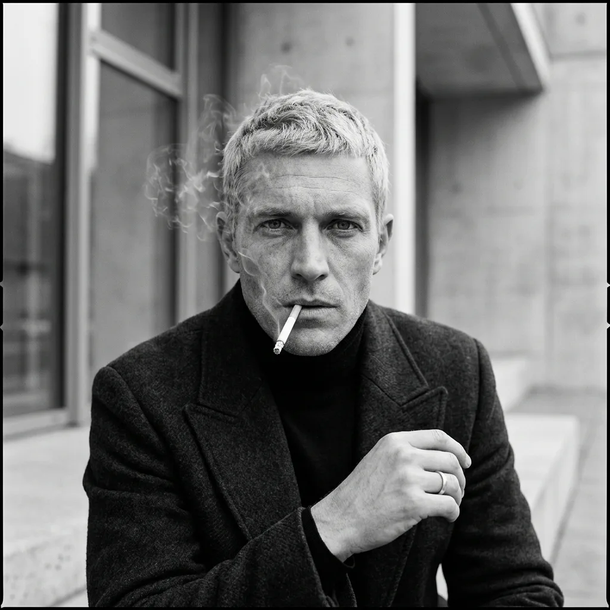

# Fashion black and white portrait of a man short

[← Back to the collection](../../README.md) · Category: [Photography](../../gallery/photography.md) · Model: `Vinano Image v2` · ID: `vn-00264`

<a href="https://vinano.ai?utm_source=github&utm_medium=readme&utm_campaign=awesome-image-video-prompts-updating&utm_content=prompt-page-image"></a>

<sub>Preview generated with <a href="https://vinano.ai?utm_source=github&utm_medium=readme&utm_campaign=awesome-image-video-prompts-updating&utm_content=prompt-page-caption">vinano.ai</a></sub>

## Prompt

```text
Ultra-realistic fashion black and white portrait of a man short light hair, wearing a dark tailored coat and a black turtleneck. They hold a cigarette between their lips as soft smoke curls around their face. Extremely detailed natural skin texture visible pores, fine lines, realistic contrast and tonal range. lifelike matte highlights. Subtle film grain, soft diffused lighting, refined minimalist background. High-fashion editorial mood, sharp details, expressive gaze, dramatic monochrome aesthetic, Hasselblad X2D, 30mm lens, strong contrast, daylight, fashion composition, architectural elements, editorial clarity medium format -p cz2pqao Keep edges clean and the overall composition balanced for a polished, gallery-ready result.
```

## Try it on vinano.ai

1. Copy the prompt above.
2. Open **[vinano.ai](https://vinano.ai?utm_source=github&utm_medium=readme&utm_campaign=awesome-image-video-prompts-updating&utm_content=prompt-page-try)**, paste it into the image generator and pick a model.
3. Swap any placeholders (brand, product, city, person…) for your own details, then generate.

More prompts like this: [Photography gallery](../../gallery/photography.md) · [all categories](../../README.md#contents)
