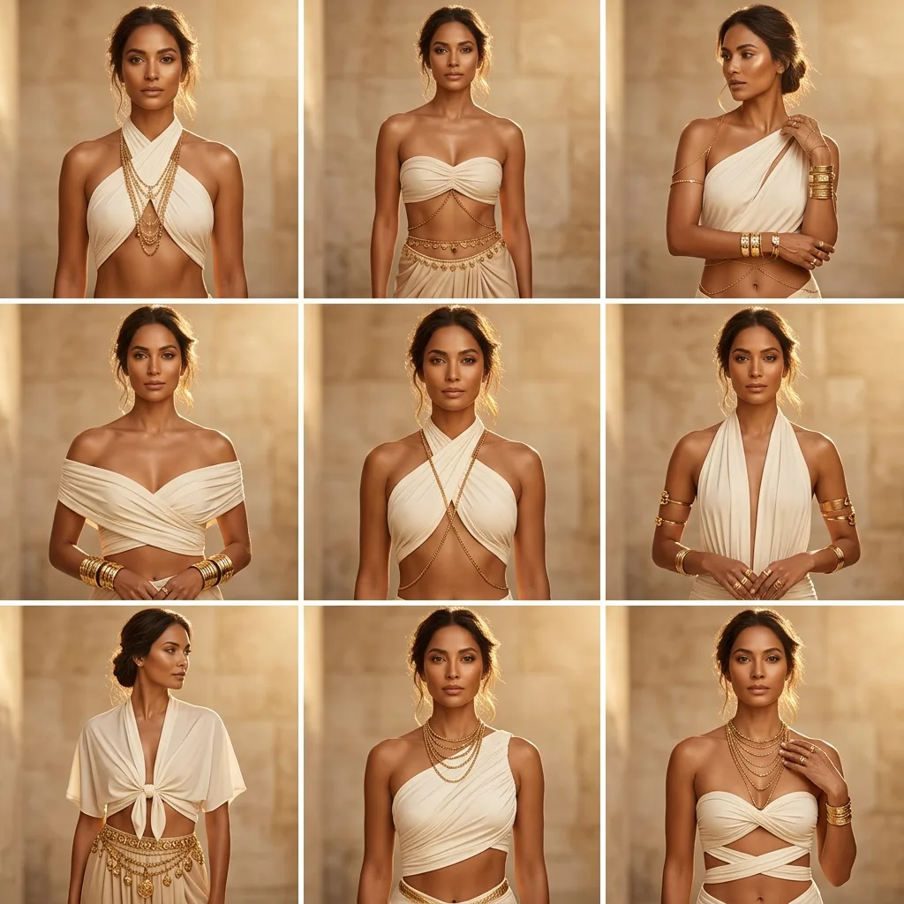

# Same elegant adult woman across all 9 panels

[← Back to the collection](../../README.md) · Category: [Photography](../../gallery/photography.md) · Model: `Vinano Image Pro` · ID: `vn-00265`

<a href="https://vinano.ai?utm_source=github&utm_medium=readme&utm_campaign=awesome-image-video-prompts-updating&utm_content=prompt-page-image"></a>

<sub>Preview generated with <a href="https://vinano.ai?utm_source=github&utm_medium=readme&utm_campaign=awesome-image-video-prompts-updating&utm_content=prompt-page-caption">vinano.ai</a></sub>

## Prompt

```text
{
 "generation_request": {
 "meta_data": {
 "tool": "",
 "task_type": "fashion_variation_grid_9panel",
 "language": "en",
 "priority": "highest",
 "version": "v1.0_GOLDEN_GODDESS_JEWELRY_9GRID"
 },
 "input": {
 "mode": "text_to_image",
 "notes": "Create a 3x3 high-fashion goddess editorial grid featuring the same elegant woman luxurious gold body jewelry and draped styling."
 },
 "output_settings": {
 "aspect_ratio": "4:5",
 "orientation": "portrait",
 "resolution_target": "ultra_high_res",
 "num_images": 1,
 "layout": {
 "type": "grid",
 "rows": 3,
 "cols": 3,
 "gutter": "thin",
 "outer_border": "none",
 "panel_consistency": "very_high"
 },
 "render_style": "golden_goddess_editorial",
 "sharpness": "editorial_crisp",
 "grain": "subtle_clean"
 },
 "scene": {
 "environment": "warm sand-toned luxury studio subtle stone texture",
 "lighting": "golden diffused light bronzed highlights on skin and jewelry",
 "mood": "divine, radiant, regal, sensual"
 },
 "subject": {
 "description": "same elegant adult woman across all 9 panels",
 "face": "same identity in all panels, calm regal expression",
 "skin": "sunlit bronzed luminous skin texture",
 "hair": "soft dark hair styled loosely back glowing face-framing strands",
 "makeup": "gold-bronze eyelids, subtle liner, luminous skin, glossy nude lips",
 "expression": "serene, elevated, goddess-like"
 },
 "wardrobe": {
 "top": "soft ivory or sand draped wrap tops goddess-inspired constructions",
 "bottom": "flowing low-rise draped bottoms",
 "accessories": "dramatic gold cuff bracelets, layered gold body chains, gold waist jewelry, delicate rings",
 "styling": "ancient goddess meets modern couture"
 },
 "composition_rules": {
 "face_visibility": "mandatory in all 9 panels",
 "framing": "mid-length to upper-thigh framing",
 "identity_consistency": "same woman in every panel"
 },
 "panel_design": {
 "panel_1": "front portrait crossed halter drape and gold chest jewelry",
 "panel_2": "front portrait bandeau drape and gold waist chain",
 "panel_3": "three-quarter portrait one-shoulder drape and layered gold accessories",
 "panel_4": "front portrait off-shoulder draped wrap and stacked gold cuffs",
 "panel_5": "front portrait sculptural crossed neckline and gold body chain",
 "panel_6": "front portrait elongated halter drape and arm jewelry",
 "panel_7": "three-quarter portrait tied-front drape and ornate waist chain",
 "panel_8": "front portrait diagonal wrapped bust and gold accents",
 "panel_9": "front portrait bandeau and crisscross waist drape, hand touching collarbone"
 },
 "camera": {
 "lens": "85mm portrait lens",
 "style": "luxury goddess fashion photography",
 "depth_of_field": "shallow",
 "angle": "eye-level"
 },
 "quality_control": {
 "identity_consistency": "maximum",
 "panel_consistency": "very_high",
 "face_priority": "absolute",
 "anatomy_accuracy": "maximum",
 "hands_priority": "very_high",
 "jewelry_integrity": "very_high",
 "fabric_realism": "high"
 },
 "negative_prompt": ["cheap costume jewelry",
 "different woman",
 "extra fingers",
 "missing fingers",
 "warped anatomy",
 "plastic skin",
 "text",
 "watermark",
 "logo"]
 }
}

Keep edges clean and the overall composition balanced for a polished, gallery-ready result.
```

## Try it on vinano.ai

1. Copy the prompt above.
2. Open **[vinano.ai](https://vinano.ai?utm_source=github&utm_medium=readme&utm_campaign=awesome-image-video-prompts-updating&utm_content=prompt-page-try)**, paste it into the image generator and pick a model.
3. Swap any placeholders (brand, product, city, person…) for your own details, then generate.

More prompts like this: [Photography gallery](../../gallery/photography.md) · [all categories](../../README.md#contents)
