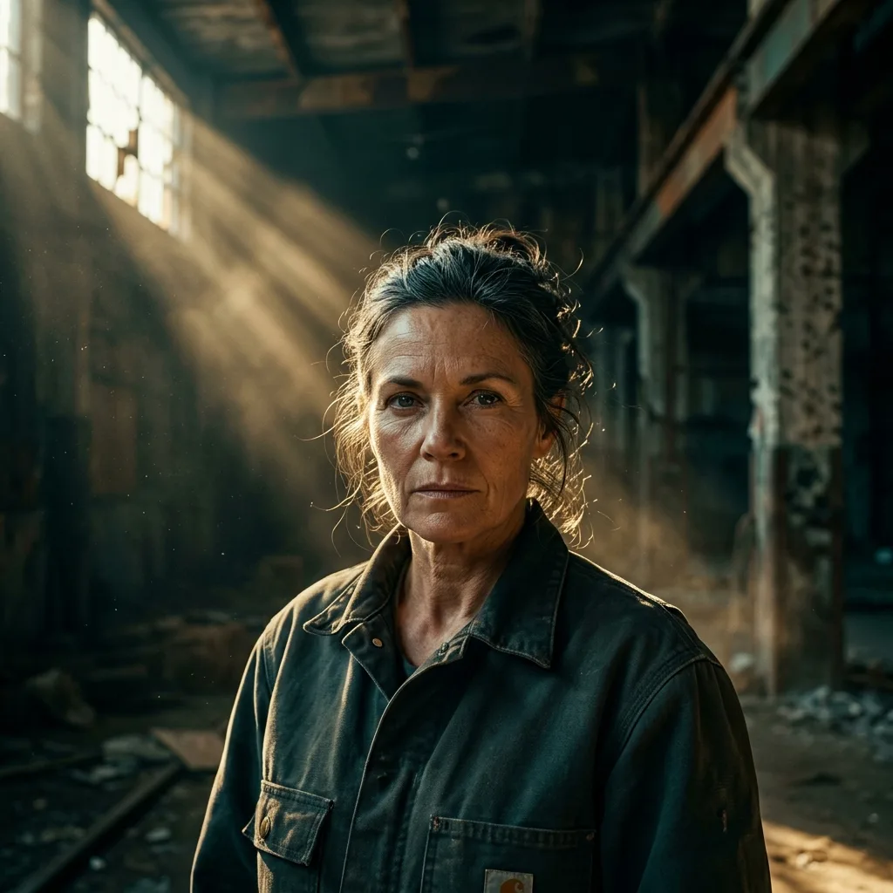

# Portrait of your description , face illuminated by dramatic

[← Back to the collection](../../README.md) · Category: [Photography](../../gallery/photography.md) · Model: `Vinano Image v2` · ID: `vn-00266`

<a href="https://vinano.ai?utm_source=github&utm_medium=readme&utm_campaign=awesome-image-video-prompts-updating&utm_content=prompt-page-image"></a>

<sub>Preview generated with <a href="https://vinano.ai?utm_source=github&utm_medium=readme&utm_campaign=awesome-image-video-prompts-updating&utm_content=prompt-page-caption">vinano.ai</a></sub>

## Prompt

```text
Portrait of [your description], face illuminated by dramatic cinematic volumetric god rays, intense shafts of golden light beams cutting through dusty abandoned warehouse, sunlight streaming through broken high windows and cracked roof, floating dust particles and haze making light visible, strong rim light and backlighting, moody high-contrast atmosphere, industrial concrete pillars and rusted metal in background, film still, epic filmic, cinematic lighting, volumetric fog, god rays, atmospheric depth, ultra-detailed skin texture, shallow depth of field, shot on 35mm Arri Alexa, cinematic color grade, teal shadows and warm golden highlights --ar 3:4 --stylize 250 --v 6 --q 2 Preserve realistic proportions and depth for a confident, professional finish.
```

## Try it on vinano.ai

1. Copy the prompt above.
2. Open **[vinano.ai](https://vinano.ai?utm_source=github&utm_medium=readme&utm_campaign=awesome-image-video-prompts-updating&utm_content=prompt-page-try)**, paste it into the image generator and pick a model.
3. Swap any placeholders (brand, product, city, person…) for your own details, then generate.

More prompts like this: [Photography gallery](../../gallery/photography.md) · [all categories](../../README.md#contents)
