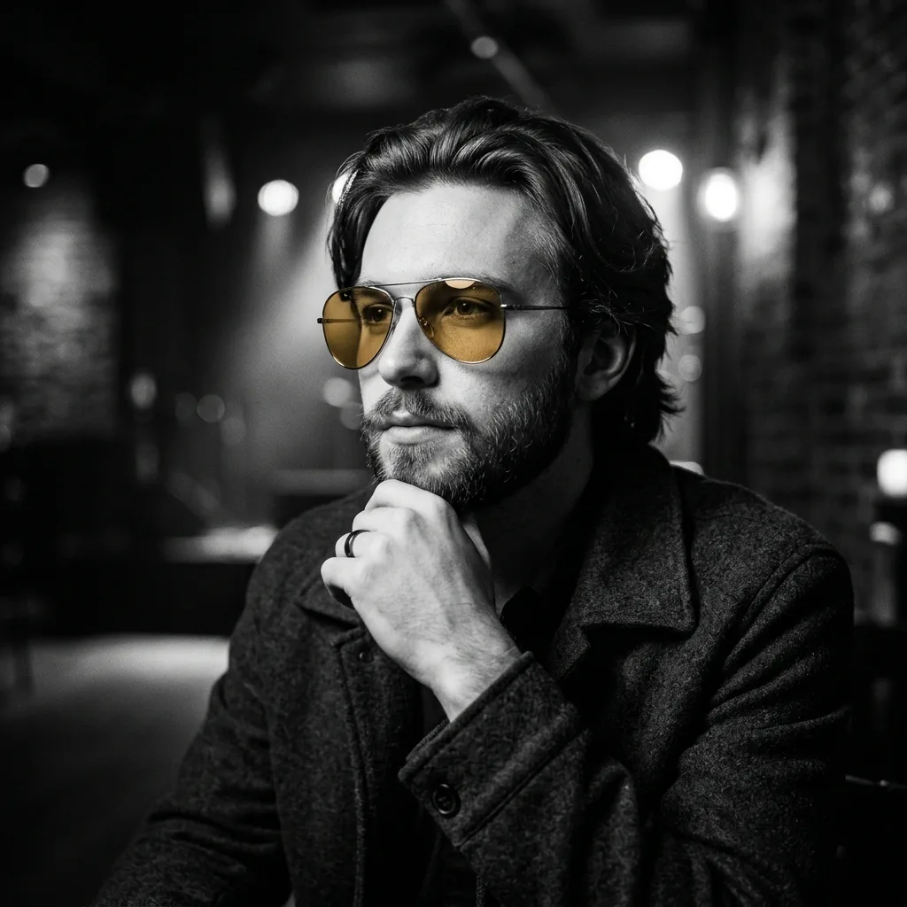

# Close-up to mid-close portrait

[← Back to the collection](../../README.md) · Category: [Photography](../../gallery/photography.md) · Model: `Vinano Image v2` · ID: `vn-00280`

<a href="https://vinano.ai?utm_source=github&utm_medium=readme&utm_campaign=awesome-image-video-prompts-updating&utm_content=prompt-page-image"></a>

<sub>Preview generated with <a href="https://vinano.ai?utm_source=github&utm_medium=readme&utm_campaign=awesome-image-video-prompts-updating&utm_content=prompt-page-caption">vinano.ai</a></sub>

## Prompt

```text
{
 "Objective": "Create a dramatic black-and-white cinematic portrait a classic film-noir mood and selective color emphasis",
 "PersonaDetails": {
 "Subject": {
 "Type": "Young man",
 "Hair": "Medium-length, naturally styled",
 "FacialHair": "Well-groomed beard",
 "Pose": "Thoughtful pose one hand resting near the chin",
 "Expression": "Introspective, confident, composed",
 "Wardrobe": "Dark jacket",
 "Accessories": {
 "Sunglasses": {
 "Type": "Stylish aviator sunglasses",
 "LensColor": "Warm amber/yellow-tinted lenses",
 "SpecialTreatment": "Only colored element in an otherwise monochrome image"
 }
 }
 }
 },
 "Composition": {
 "Framing": "Close-up to mid-close portrait",
 "Angle": "Eye-level, slightly cinematic framing",
 "DepthOfField": "Shallow depth of field",
 "Focus": "Sharp focus on facial features and sunglasses"
 },
 "LightingAndAtmosphere": {
 "LightingStyle": "Strong cinematic backlighting",
 "Effects": ["Glowing bokeh lights in the background",
 "Studio or stage-light appearance"],
 "Contrast": "High contrast deep blacks and bright highlights",
 "Mood": "Moody, dramatic, contemplative"
 },
 "ArtDirection": {
 "Style": "Classic film-noir photography",
 "ColorTreatment": {
 "Base": "Black-and-white",
 "Accent": "Selective color on amber/yellow lenses"
 },
 "TextureDetail": "Ultra-detailed skin, hair, and fabric textures",
 "Aesthetic": "Elegant, timeless, cinematic"
 },
 "PhotographyStyle": {
 "Genre": "Professional cinematic portrait photography",
 "ImageQuality": "Ultra-high resolution, crisp detail",
 "Finish": "Refined, editorial, gallery-worthy"
 },
 "Mood": {
 "Tone": "Serious, reflective, stylish",
 "EmotionalFeel": "Quiet intensity and classic masculinity"
 },
 "NegativePrompt": ["full color image",
 "flat lighting",
 "low contrast",
 "modern casual snapshot",
 "oversharpening",
 "plastic skin",
 "cartoon",
 "anime"],
 "ResponseFormat": {
 "Type": "Single image",
 "Orientation": "Portrait",
 "AspectRatio": "2:3"
 }
}

Render with rich micro-detail while keeping the layout uncluttered and intentional.
```

## Try it on vinano.ai

1. Copy the prompt above.
2. Open **[vinano.ai](https://vinano.ai?utm_source=github&utm_medium=readme&utm_campaign=awesome-image-video-prompts-updating&utm_content=prompt-page-try)**, paste it into the image generator and pick a model.
3. Swap any placeholders (brand, product, city, person…) for your own details, then generate.

More prompts like this: [Photography gallery](../../gallery/photography.md) · [all categories](../../README.md#contents)
