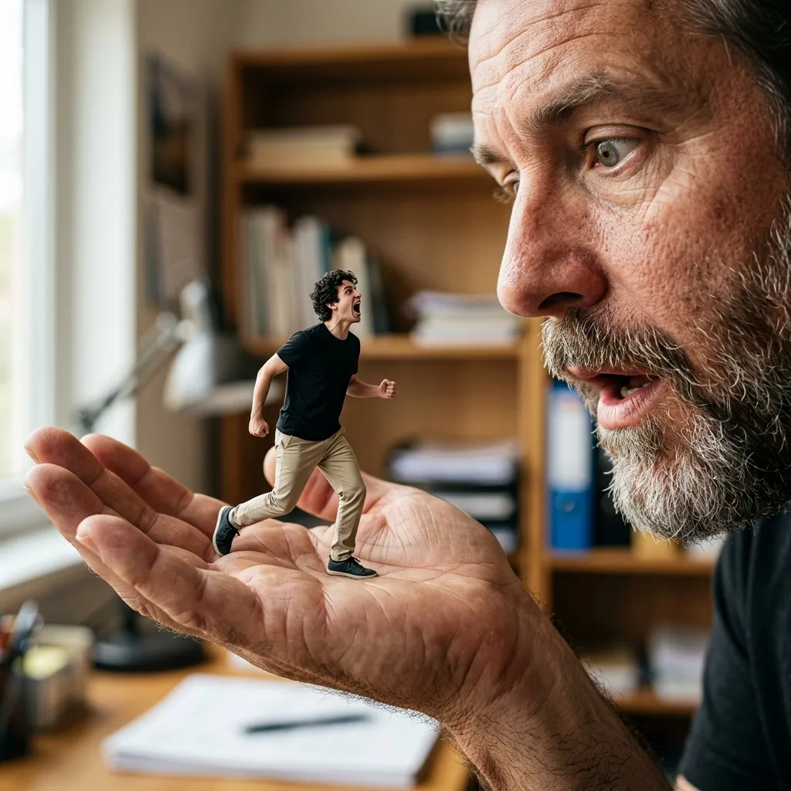

# 8k, high-fidelity photograph captured a wide-angle lens and shallow

[← Back to the collection](../../README.md) · Category: [Photography](../../gallery/photography.md) · Model: `Vinano Image v2` · ID: `vn-00283`

<a href="https://vinano.ai?utm_source=github&utm_medium=readme&utm_campaign=awesome-image-video-prompts-updating&utm_content=prompt-page-image"></a>

<sub>Preview generated with <a href="https://vinano.ai?utm_source=github&utm_medium=readme&utm_campaign=awesome-image-video-prompts-updating&utm_content=prompt-page-caption">vinano.ai</a></sub>

## Prompt

```text
A hyper-realistic, 8k, high-fidelity photograph captured a wide-angle lens and shallow depth of field, creating a dramatic forced perspective. The composition features a colossal human face and hand on the right side, filling the frame, the hand extended palm-up towards the left. The giant person, a full beard and mustache, has their mouth slightly agape in an expression of surprise or speech, looking down towards their palm. On the palm of this giant hand stands a miniature person, appearing tiny in comparison, wearing a black short-sleeved t-shirt and light khaki pants, dark curly hair. This miniature figure is captured mid-action, arms slightly bent and legs in a dynamic, running or reacting pose, also an open mouth as if shouting or speaking. The background is an extremely blurred, warm-toned indoor setting, suggesting an office or study hints of wooden shelves and a blue binder, providing a soft bokeh effect. filmic, cinematic lighting illuminates the scene soft, warm light, highlighting the highly detailed texture of the skin, hair, and clothing, while maintaining a natural, diffused quality. The character's face for both the giant and the miniature person is: uploaded face as reference. Maintain consistent colour harmony and crisp focus across the whole frame.
```

## Try it on vinano.ai

1. Copy the prompt above.
2. Open **[vinano.ai](https://vinano.ai?utm_source=github&utm_medium=readme&utm_campaign=awesome-image-video-prompts-updating&utm_content=prompt-page-try)**, paste it into the image generator and pick a model.
3. Swap any placeholders (brand, product, city, person…) for your own details, then generate.

More prompts like this: [Photography gallery](../../gallery/photography.md) · [all categories](../../README.md#contents)
