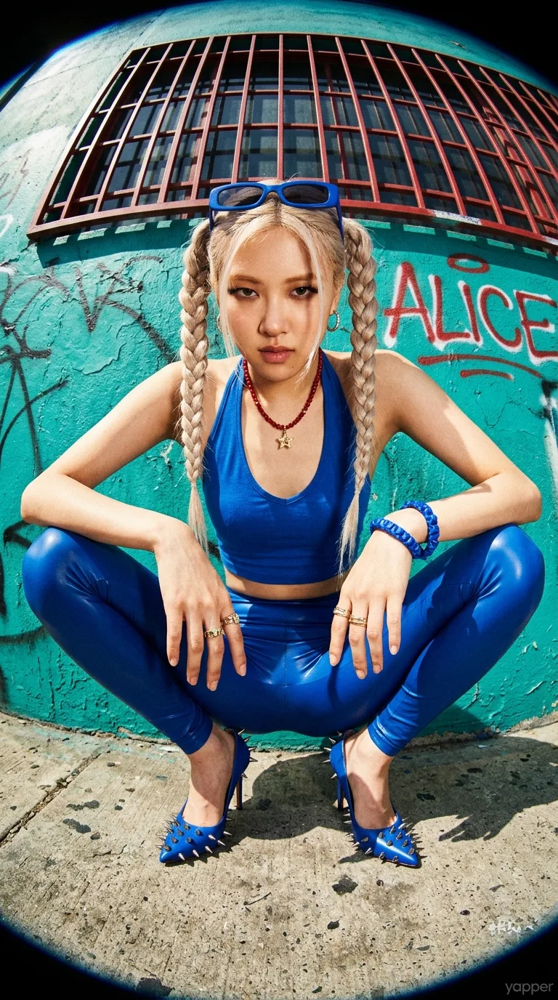

# Highly detailed, true-to-life photorealistic 8K streetwear fashion portrait

[← Back to the collection](../../README.md) · Category: [Photography](../../gallery/photography.md) · Model: `Vinano Image v2` · ID: `vn-00285`

<a href="https://vinano.ai?utm_source=github&utm_medium=readme&utm_campaign=awesome-image-video-prompts-updating&utm_content=prompt-page-image"></a>

<sub>Preview generated with <a href="https://vinano.ai?utm_source=github&utm_medium=readme&utm_campaign=awesome-image-video-prompts-updating&utm_content=prompt-page-caption">vinano.ai</a></sub>

## Prompt

```text
Generate a highly detailed, true-to-life photorealistic 8K streetwear fashion portrait of Rosé of Blackpink, who is dominating about 90% of the frame. The shot is taken from a low angle a close-up perspective, a wide-angle lens heavy fisheye distortion to simulate a photo taken on a modern smartphone. She has her signature bleached blonde hair in thick pigtail braids, pale porcelain skin, and a confident expression. She is in a low, crouched squat position on the floor, balancing on the spiked high heels and both hands are placed flat on her thighs, leaning slightly forward, and looking directly at the camera. Cobalt-framed rectangular retro sunglasses slightly away from her eyes both hands. She is wearing a cobalt blue cotton halter crop top, tight cobalt blue latex leggings, and cobalt blue high heels. Her accessories include a ruby bead necklace a gold star pendant, silver hoop earrings, gold rings, and a cobalt blue bracelet a raised texture. The outdoor setting features a vibrant, textured teal wall behind her a graffiti written 'Alice' and a red metal grate above. The scene is lit by intense, direct daytime sunlight, creating hard shadows and high contrast. A small "yapper" watermark is in the bottom right corner. Aspect ratio 9:16. Aim for an editorial, design-driven look with deliberate negative space.
```

## Try it on vinano.ai

1. Copy the prompt above.
2. Open **[vinano.ai](https://vinano.ai?utm_source=github&utm_medium=readme&utm_campaign=awesome-image-video-prompts-updating&utm_content=prompt-page-try)**, paste it into the image generator and pick a model.
3. Swap any placeholders (brand, product, city, person…) for your own details, then generate.

More prompts like this: [Photography gallery](../../gallery/photography.md) · [all categories](../../README.md#contents)
