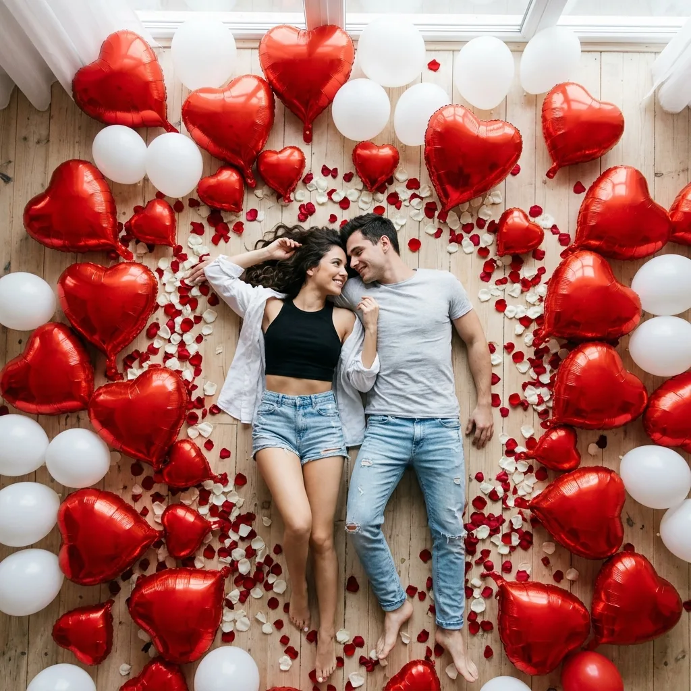

# 8k high-angle overhead shot, captured a wide-angle lens, presents

[← Back to the collection](../../README.md) · Category: [Photography](../../gallery/photography.md) · Model: `Vinano Image v2` · ID: `vn-00286`

<a href="https://vinano.ai?utm_source=github&utm_medium=readme&utm_campaign=awesome-image-video-prompts-updating&utm_content=prompt-page-image"></a>

<sub>Preview generated with <a href="https://vinano.ai?utm_source=github&utm_medium=readme&utm_campaign=awesome-image-video-prompts-updating&utm_content=prompt-page-caption">vinano.ai</a></sub>

## Prompt

```text
A hyper-realistic 8k high-angle overhead shot, captured a wide-angle lens, presents a romantic scene of a couple lying on a light-colored wooden floor. The lighting is soft and natural, possibly from a window, creating gentle highlights on the balloons and subtle shadows on the floor, contributing to a cinematic atmosphere. The female subject, uploaded face as reference, is positioned on her back, wearing a black crop top, light blue denim shorts, and a white unbuttoned shirt draped over her. Her left arm is bent her hand near her head, and her right arm is gently extended towards the male. The male subject, uploaded face as reference, is also on his back, wearing a light grey t-shirt and light blue distressed denim jeans. His left arm is bent, hand near the female's head, and his right arm is relaxed. They are lying close together, heads touching, looking into each other's eyes soft, affectionate smiles. The entire floor around and between them is densely decorated a multitude of shiny red heart-shaped foil balloons of varying sizes, interspersed several white round latex balloons, and countless small red and white rose petals, creating a highly detailed texture and vibrant color contrast against the light wood. The composition is a full-body shot, showcasing the couple and the extensive, immersive decorations. Preserve realistic proportions and depth for a confident, professional finish.
```

## Try it on vinano.ai

1. Copy the prompt above.
2. Open **[vinano.ai](https://vinano.ai?utm_source=github&utm_medium=readme&utm_campaign=awesome-image-video-prompts-updating&utm_content=prompt-page-try)**, paste it into the image generator and pick a model.
3. Swap any placeholders (brand, product, city, person…) for your own details, then generate.

More prompts like this: [Photography gallery](../../gallery/photography.md) · [all categories](../../README.md#contents)
