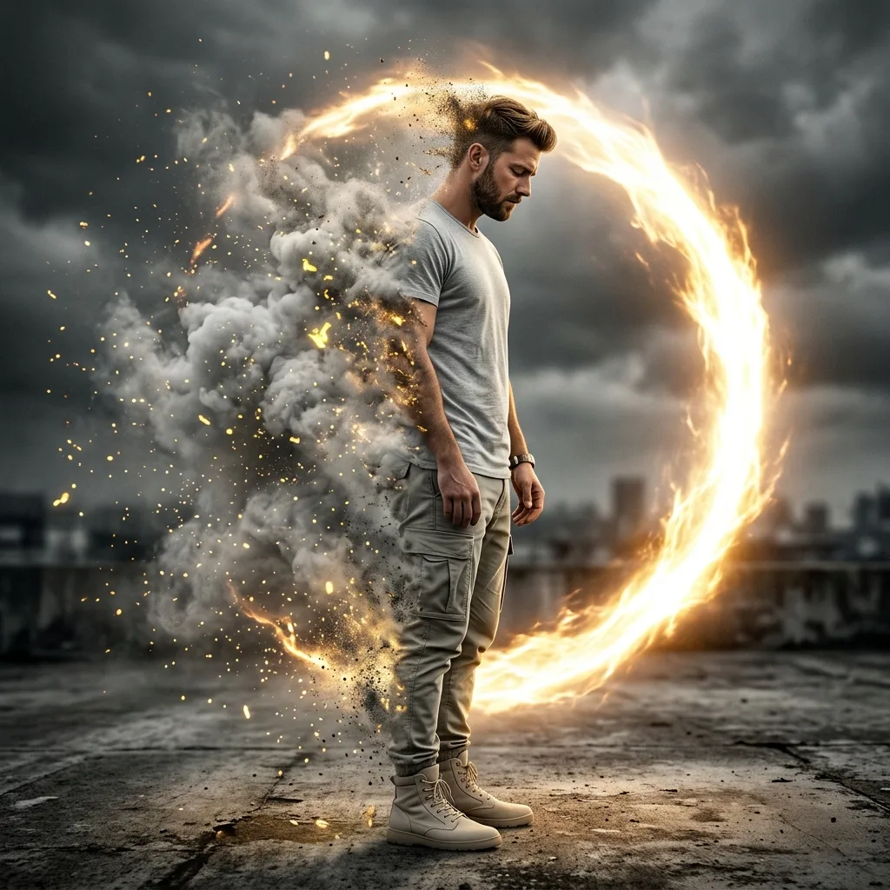

# 8K image high-contrast dramatic lighting and a photo-real digital

[← Back to the collection](../../README.md) · Category: [Photography](../../gallery/photography.md) · Model: `Vinano Image v2` · ID: `vn-00293`

<a href="https://vinano.ai?utm_source=github&utm_medium=readme&utm_campaign=awesome-image-video-prompts-updating&utm_content=prompt-page-image"></a>

<sub>Preview generated with <a href="https://vinano.ai?utm_source=github&utm_medium=readme&utm_campaign=awesome-image-video-prompts-updating&utm_content=prompt-page-caption">vinano.ai</a></sub>

## Prompt

```text
Create an ultra-realistic, cinematic 8K image high-contrast dramatic lighting and a photo-real digital painting aesthetic-use face reference exactly. The man is shown in a full-body side profile facing right, his face and hairstyle copied perfectly no alterations He wears modern casual streetwear; a light grey crewneck t-shirt, light neutral cargo pants, light-colored high-top boots, and a watch on his left wrist. His posture is slightly slumped, head bowed, eyes looking downward, hands relaxed at his sides, conveying deep introspection and sorrow. Nearly half of his body is dissolving into extremely thick, cloud-like grey smoke filled glowing yellow dust particles. His left arm, shoulder, torso, legs, and part of his hair become transparent as they break into luminous particles, suggesting active disintegration Behind and partially surrounding him is a massive glowing crescent (C-shaped) energy aura, emitting fiery golden-white plasma light. This aura acts as a powerful rim and backlight, highlighting the smoke, dust, and silhouette. The setting is minimal and stark: a concrete or desolate paved surface meeting a heavily overcast sky. The color palette is nearly monochrome greys and whites, contrasted by intense amber-gold glow, Shallow depth of field, glow/bloom lighting, particle dispersion, cinematic composition, emotional and dramatic atmosphere. Maintain consistent colour harmony and crisp focus across the whole frame.
```

## Try it on vinano.ai

1. Copy the prompt above.
2. Open **[vinano.ai](https://vinano.ai?utm_source=github&utm_medium=readme&utm_campaign=awesome-image-video-prompts-updating&utm_content=prompt-page-try)**, paste it into the image generator and pick a model.
3. Swap any placeholders (brand, product, city, person…) for your own details, then generate.

More prompts like this: [Photography gallery](../../gallery/photography.md) · [all categories](../../README.md#contents)
