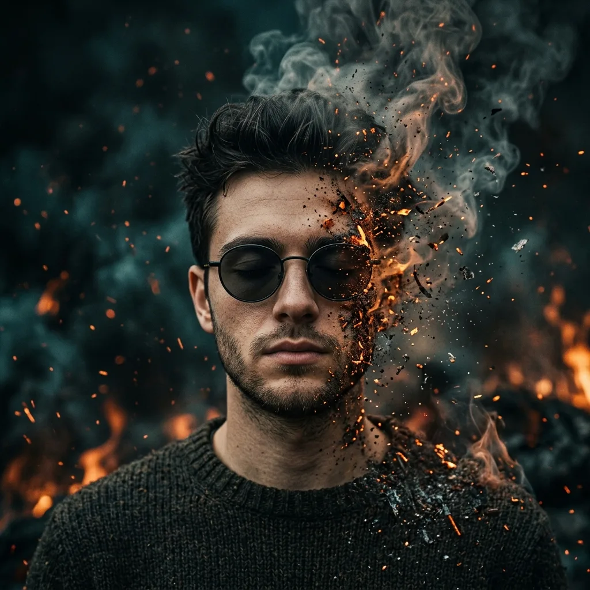

# Surreal cinematic portrait of a young man oval sunglasses

[← Back to the collection](../../README.md) · Category: [Photography](../../gallery/photography.md) · Model: `Vinano Image v2` · ID: `vn-00295`

<a href="https://vinano.ai?utm_source=github&utm_medium=readme&utm_campaign=awesome-image-video-prompts-updating&utm_content=prompt-page-image"></a>

<sub>Preview generated with <a href="https://vinano.ai?utm_source=github&utm_medium=readme&utm_campaign=awesome-image-video-prompts-updating&utm_content=prompt-page-caption">vinano.ai</a></sub>

## Prompt

```text
A surreal cinematic portrait of a young man oval sunglasses, eyes closed, calm expression, standing against a dark firey moody background. The right side of his face is disintegrating into smoke, ash, and glowing embers, as if slowly burning away into the air. Fine particles, sparks, and debris float upward, blending seamlessly into thick swirling smoke above his head. Dramatic low-key lighting, high contrast, ultra-detailed skin texture, true-to-life photorealistic, shallow depth of field, 85mm lens, dark teal and charcoal color palette, emotional and introspective mood, ultra high resolution, masterpiece, volumetric smoke, cinematic composition. Emphasise material texture and natural light so the final frame feels tactile and premium.
```

## Try it on vinano.ai

1. Copy the prompt above.
2. Open **[vinano.ai](https://vinano.ai?utm_source=github&utm_medium=readme&utm_campaign=awesome-image-video-prompts-updating&utm_content=prompt-page-try)**, paste it into the image generator and pick a model.
3. Swap any placeholders (brand, product, city, person…) for your own details, then generate.

More prompts like this: [Photography gallery](../../gallery/photography.md) · [all categories](../../README.md#contents)
