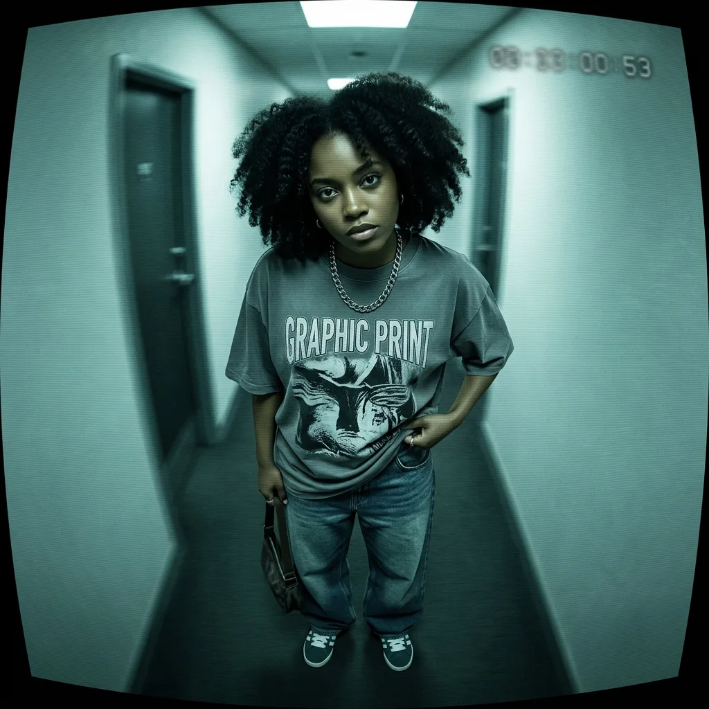

# Use uploaded selfie as ONLY face reference

[← Back to the collection](../../README.md) · Category: [Photography](../../gallery/photography.md) · Model: `Vinano Image v2` · ID: `vn-00298`

<a href="https://vinano.ai?utm_source=github&utm_medium=readme&utm_campaign=awesome-image-video-prompts-updating&utm_content=prompt-page-image"></a>

<sub>Preview generated with <a href="https://vinano.ai?utm_source=github&utm_medium=readme&utm_campaign=awesome-image-video-prompts-updating&utm_content=prompt-page-caption">vinano.ai</a></sub>

## Prompt

```text
Use uploaded selfie as ONLY face reference; preserve exact likeness/age/hair and natural skin texture; no beautification, no face mixing. Ultra-realistic CCTV/security camera still frame in a building hallway: ceiling corner mount view (high angle 60-70° top-down), wide 2.8-3.6mm fisheye barrel distortion, edge warping. Subject centered under the camera, looking up directly into lens a cool unbothered expression, one hand adjusting the waistband, the other holding a bag strap or hanging relaxed. Outfit (strict, unisex): oversized graphic print T-shirt (generic print, no readable text/logos), wide baggy jeans, Adidas Campus sneakers (recognizable silhouette), chunky chain necklace. CCTV look: low-light greenish/blue tint, interlaced scanlines, H.264 block compression, mild noise, slight motion smear on background only, timestamp/HUD present but blurred/unreadable (no readable text), vignetting, ceiling light glare. Face is the sharpest point. 3:4 Maintain consistent colour harmony and crisp focus across the whole frame.
```

## Try it on vinano.ai

1. Copy the prompt above.
2. Open **[vinano.ai](https://vinano.ai?utm_source=github&utm_medium=readme&utm_campaign=awesome-image-video-prompts-updating&utm_content=prompt-page-try)**, paste it into the image generator and pick a model.
3. Swap any placeholders (brand, product, city, person…) for your own details, then generate.

More prompts like this: [Photography gallery](../../gallery/photography.md) · [all categories](../../README.md#contents)
