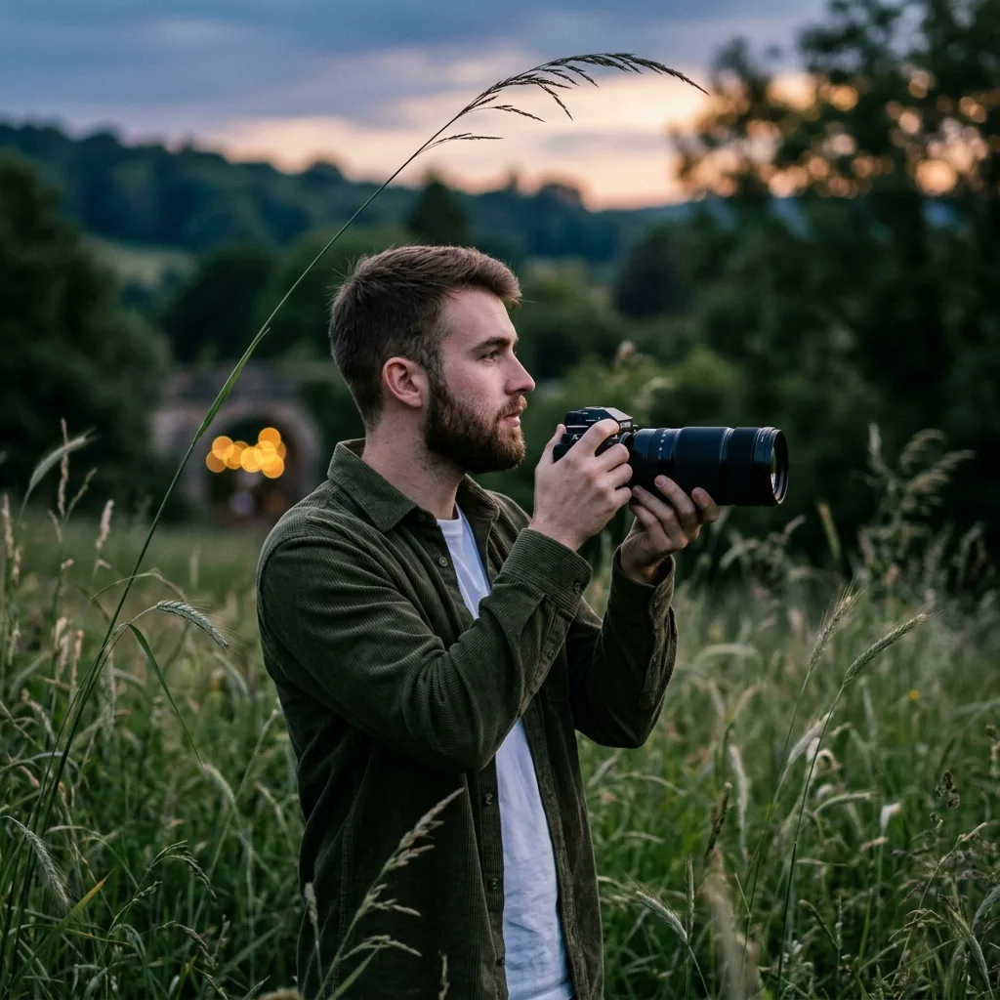

# Medium shot of a young man a trimmed beard

[← Back to the collection](../../README.md) · Category: [Photography](../../gallery/photography.md) · Model: `Vinano Image v2` · ID: `vn-00301`

<a href="https://vinano.ai?utm_source=github&utm_medium=readme&utm_campaign=awesome-image-video-prompts-updating&utm_content=prompt-page-image"></a>

<sub>Preview generated with <a href="https://vinano.ai?utm_source=github&utm_medium=readme&utm_campaign=awesome-image-video-prompts-updating&utm_content=prompt-page-caption">vinano.ai</a></sub>

## Prompt

```text
Cinematic medium shot of a young man a trimmed beard and short brown hair, standing upright in a lush meadow at
twilight. He is captured in profile, looking toward the right, holding a professional black mirrorless camera a long
telephoto lens to his eye level. He wears an olive green corduroy button-down shirt over a plain white t-shirt. The man's chest below the area is hidden inside the grass. The foreground features
tall, sharp blades of grass and soft, out-of-focus wheat stalks creating a natural frame. The foreground is filled tall, deeply blurred wispy wild grasses, one very prominent blade
starting near the camera and arcing high above and across his head, creating a strong layer of depth. The background is a
masterclass in bokeh: deep moody blues and greens of distant rolling hills and trees, a soft motion blur effect on the foliage Large, warm golden bokeh light orbs glow softly in the distance
near a blurred stone archway. High-end photography, 85mm lens, f/1.8, moody atmosphere, sharp focus on the subject a creamy, cinematic background. ar 4:5

Preserve realistic proportions and depth for a confident, professional finish.
```

## Try it on vinano.ai

1. Copy the prompt above.
2. Open **[vinano.ai](https://vinano.ai?utm_source=github&utm_medium=readme&utm_campaign=awesome-image-video-prompts-updating&utm_content=prompt-page-try)**, paste it into the image generator and pick a model.
3. Swap any placeholders (brand, product, city, person…) for your own details, then generate.

More prompts like this: [Photography gallery](../../gallery/photography.md) · [all categories](../../README.md#contents)
