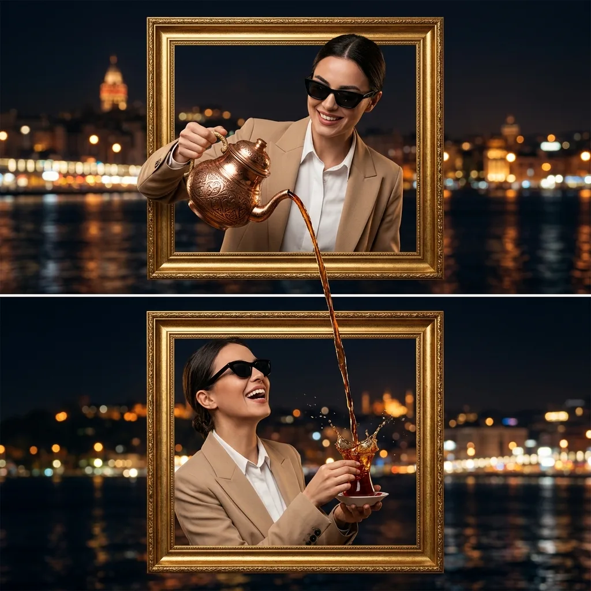

# Two-frame composition

[← Back to the collection](../../README.md) · Category: [Photography](../../gallery/photography.md) · Model: `Vinano Image v2` · ID: `vn-00303`

<a href="https://vinano.ai?utm_source=github&utm_medium=readme&utm_campaign=awesome-image-video-prompts-updating&utm_content=prompt-page-image"></a>

<sub>Preview generated with <a href="https://vinano.ai?utm_source=github&utm_medium=readme&utm_campaign=awesome-image-video-prompts-updating&utm_content=prompt-page-caption">vinano.ai</a></sub>

## Prompt

```text
Ultra-realistic cinematic two-frame composition. In the top golden vintage frame, an elegant stylish woman wearing a beige blazer, white shirt, and black sunglasses smiles while pouring tea from an ornate engraved copper teapot outward from the frame. The tea flows smoothly out of the frame into the lower frame. In the bottom golden frame, the same woman tilts her head back slightly a joyful expression, holding a traditional Turkish tea glass as the tea splashes dramatically into it mid-air. Nighttime city skyline warm glowing lights and water reflections in the background, shallow depth of field, dramatic lighting, high detail, surreal perspective illusion where the liquid connects both frames, cinematic photography, ultra realistic, 8k. Keep edges clean and the overall composition balanced for a polished, gallery-ready result.
```

## Try it on vinano.ai

1. Copy the prompt above.
2. Open **[vinano.ai](https://vinano.ai?utm_source=github&utm_medium=readme&utm_campaign=awesome-image-video-prompts-updating&utm_content=prompt-page-try)**, paste it into the image generator and pick a model.
3. Swap any placeholders (brand, product, city, person…) for your own details, then generate.

More prompts like this: [Photography gallery](../../gallery/photography.md) · [all categories](../../README.md#contents)
