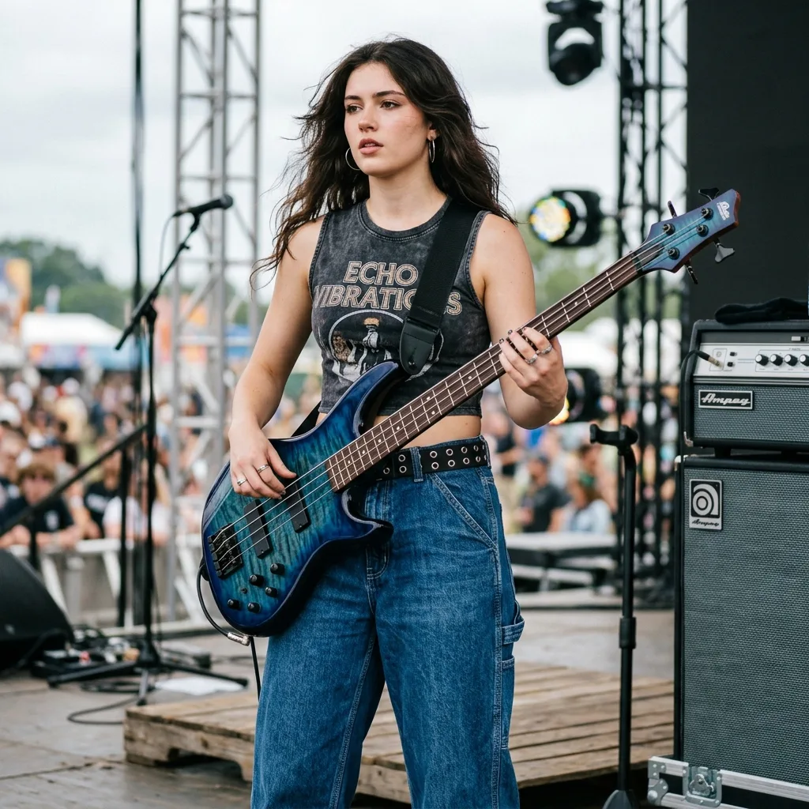

# Image generation prompt

[← Back to the collection](../../README.md) · Category: [Photography](../../gallery/photography.md) · Model: `Vinano Image v2` · ID: `vn-00305`

<a href="https://vinano.ai?utm_source=github&utm_medium=readme&utm_campaign=awesome-image-video-prompts-updating&utm_content=prompt-page-image"></a>

<sub>Preview generated with <a href="https://vinano.ai?utm_source=github&utm_medium=readme&utm_campaign=awesome-image-video-prompts-updating&utm_content=prompt-page-caption">vinano.ai</a></sub>

## Prompt

```text
{
 "image_generation_prompt": {
 "subject": {
 "main": "young female musician bass guitarist performing live on an outdoor stage",
 "appearance": "long dark wavy layered hair blowing slightly in wind, fair skin, intense focused facial expression, natural makeup, silver hoop earrings",
 "pose": "standing confidently holding a bass guitar, fingers plucking strings, looking slightly off-camera to the left"
 },
 "attire": {
 "top": "sleeveless dark grey acid-wash graphic crop top vintage band aesthetic",
 "bottoms": "loose fit wide-leg blue denim carpenter jeans large pockets",
 "accessories": "black leather belt double row silver grommets, wide black guitar strap"
 },
 "instrument": {
 "type": "modern electric bass guitar",
 "details": "deep blue burst finish visible wood grain texture (quilted maple top), black hardware, long guitar neck, intricate fretboard details"
 },
 "environment": {
 "setting": "daytime outdoor concert stage, open air festival vibe",
 "background_elements": "blurred stage truss structures, black bass amplifier stack metal grille, microphone stand on the left, overcast bright sky"
 },
 "technical_style": {
 "quality": "ultra realistic, 8k uhd, hdr, masterwork, sharp focus, high fidelity textures",
 "lighting": "natural diffuse daylight, soft shadows, filmic, cinematic lighting",
 "camera": "telephoto lens, depth of field, bokeh background, portrait photography"
 }
 },
 "parameters": {
 "aspect_ratio": "9:16",
 "orientation": "vertical long",
 "resolution": "highest possible"
 }
}

Emphasise material texture and natural light so the final frame feels tactile and premium.
```

## Try it on vinano.ai

1. Copy the prompt above.
2. Open **[vinano.ai](https://vinano.ai?utm_source=github&utm_medium=readme&utm_campaign=awesome-image-video-prompts-updating&utm_content=prompt-page-try)**, paste it into the image generator and pick a model.
3. Swap any placeholders (brand, product, city, person…) for your own details, then generate.

More prompts like this: [Photography gallery](../../gallery/photography.md) · [all categories](../../README.md#contents)
