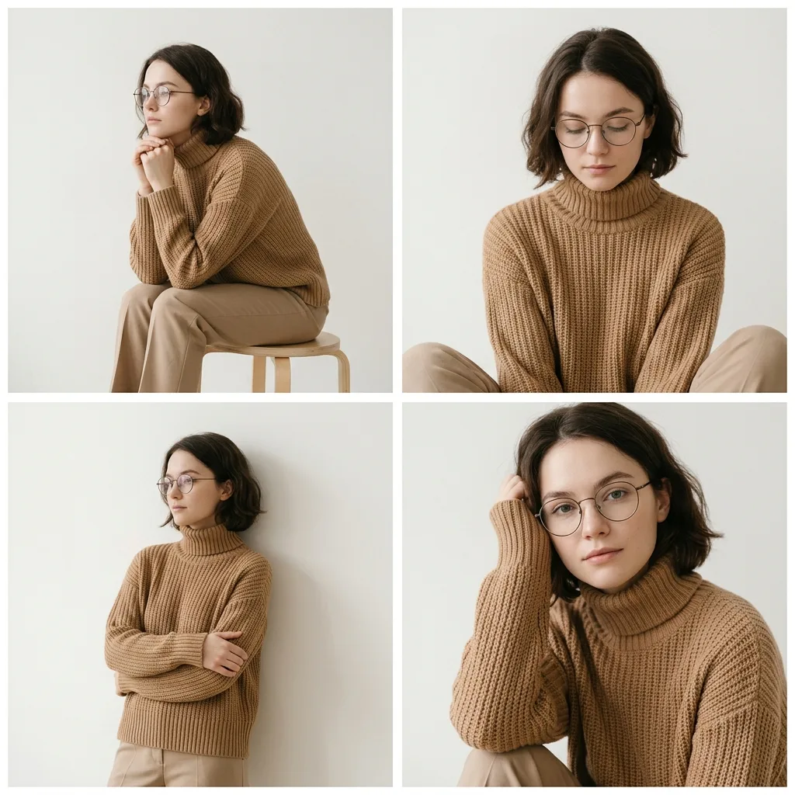

# Refined minimalist studio

[← Back to the collection](../../README.md) · Category: [Photography](../../gallery/photography.md) · Model: `Vinano Image v2` · ID: `vn-00310`

<a href="https://vinano.ai?utm_source=github&utm_medium=readme&utm_campaign=awesome-image-video-prompts-updating&utm_content=prompt-page-image"></a>

<sub>Preview generated with <a href="https://vinano.ai?utm_source=github&utm_medium=readme&utm_campaign=awesome-image-video-prompts-updating&utm_content=prompt-page-caption">vinano.ai</a></sub>

## Prompt

```text
{
 "Objective": "Create a refined minimalist fashion studio portrait series a calm, Scandinavian editorial mood",
 "PersonaDetails": {
 "Subject": {
 "Type": "Young woman",
 "Hair": "Short, softly waved dark-brown hair",
 "Accessories": "Thin round eyeglasses",
 "Expression": "Calm, introspective",
 "Skin": "Natural skin texture minimal retouching"
 }
 },
 "Wardrobe": {
 "Top": "Chunky camel-colored knit turtleneck sweater",
 "Bottom": "Beige trousers",
 "Style": "Timeless autumn fashion"
 },
 "SceneDescription": {
 "Environment": "refined minimalist studio",
 "Background": "Neutral off-white backdrop",
 "OverallFeel": "Clean, airy, understated"
 },
 "PortraitSeries": {
 "SeriesType": "Four-image set",
 "Poses": [{
 "Description": "Seated pose hands gently clasped under the chin",
 "Mood": "Quiet, reflective"
 },
 {
 "Description": "Front-facing portrait eyes lowered",
 "Mood": "Soft, contemplative"
 },
 {
 "Description": "Three-quarter side profile arms crossed",
 "Mood": "Poised, thoughtful"
 },
 {
 "Description": "Close-up portrait sweater sleeve raised near the face",
 "Mood": "Intimate, tactile"
 }]
 },
 "Composition": {
 "Framing": "Varied framing from close-up to mid-length",
 "NegativeSpace": "Generous, balanced negative space",
 "DepthOfField": "Shallow depth of field for gentle separation"
 },
 "LightingAndColor": {
 "Lighting": "Soft, diffused studio lighting",
 "Highlights": "Subtle, natural highlights",
 "ColorPalette": "Muted warm neutrals (camel, beige, off-white)"
 },
 "ArtDirection": {
 "Style": "Scandinavian editorial photography",
 "Aesthetic": "refined minimalist, timeless, understated luxury",
 "TextureEmphasis": "Knit fabric and natural skin detail"
 },
 "PhotographyStyle": {
 "Genre": "Professional fashion studio photography",
 "RealismLevel": "High realism restrained processing",
 "Finish": "Clean, modern, magazine-ready"
 },
 "Mood": {
 "Tone": "Calm, introspective, serene",
 "SeasonalFeel": "Autumn warmth and quiet elegance"
 },
 "NegativePrompt": ["busy background",
 "harsh lighting",
 "bold colors",
 "heavy makeup",
 "over-retouching",
 "glossy fashion look",
 "street photography"],
 "ResponseFormat": {
 "Type": "Portrait series",
 "ImageCount": 4,
 "Orientation": "Portrait",
 "AspectRatio": "2:3"
 }
}

Maintain consistent colour harmony and crisp focus across the whole frame.
```

## Try it on vinano.ai

1. Copy the prompt above.
2. Open **[vinano.ai](https://vinano.ai?utm_source=github&utm_medium=readme&utm_campaign=awesome-image-video-prompts-updating&utm_content=prompt-page-try)**, paste it into the image generator and pick a model.
3. Swap any placeholders (brand, product, city, person…) for your own details, then generate.

More prompts like this: [Photography gallery](../../gallery/photography.md) · [all categories](../../README.md#contents)
