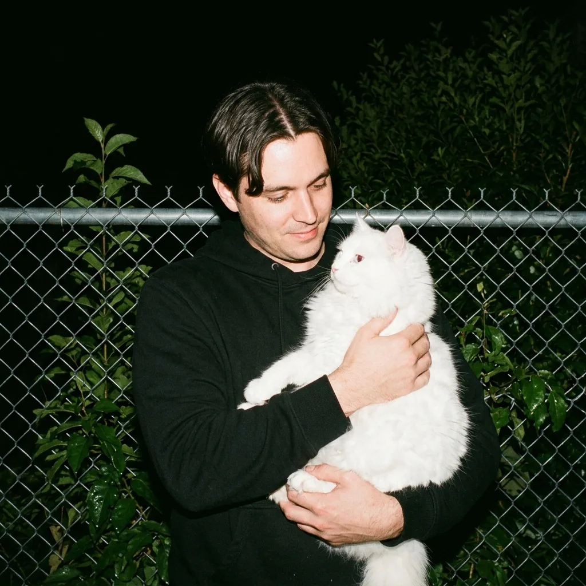

# Raw, candid smartphone-style photo taken at night a soft

[← Back to the collection](../../README.md) · Category: [Photography](../../gallery/photography.md) · Model: `Vinano Image v2` · ID: `vn-00313`

<a href="https://vinano.ai?utm_source=github&utm_medium=readme&utm_campaign=awesome-image-video-prompts-updating&utm_content=prompt-page-image"></a>

<sub>Preview generated with <a href="https://vinano.ai?utm_source=github&utm_medium=readme&utm_campaign=awesome-image-video-prompts-updating&utm_content=prompt-page-caption">vinano.ai</a></sub>

## Prompt

```text
A raw, candid smartphone-style photo taken at night a soft bright, direct camera flash, use my face on this image, featuring a man middle-parted dark hair and a soft, gentle expression looking affectionately at a large, fluffy white cat that he is holding in his arms. The man is wearing a plain black hoodie, and the cat is looking back at him, creating a heartwarming moment. The background consists of a metal chain-link fence some dark green leafy plants visible behind it, all set against a pitch-black night sky. The lighting has a nostalgic, slightly grainy 2010s digital camera aesthetic high contrast, sharp shadows, and a natural, unpolished vibe. Render with rich micro-detail while keeping the layout uncluttered and intentional.
```

## Try it on vinano.ai

1. Copy the prompt above.
2. Open **[vinano.ai](https://vinano.ai?utm_source=github&utm_medium=readme&utm_campaign=awesome-image-video-prompts-updating&utm_content=prompt-page-try)**, paste it into the image generator and pick a model.
3. Swap any placeholders (brand, product, city, person…) for your own details, then generate.

More prompts like this: [Photography gallery](../../gallery/photography.md) · [all categories](../../README.md#contents)
