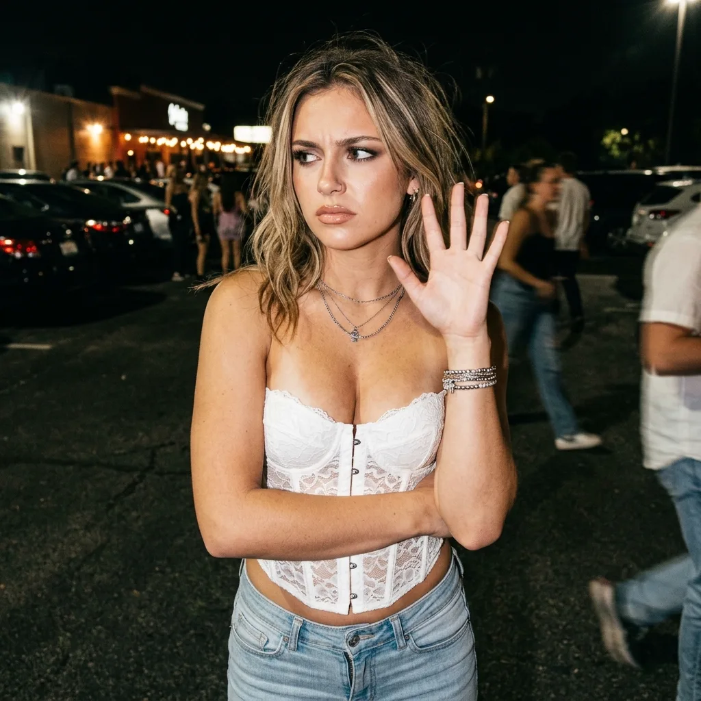

# Parking lot outside a party venue

[← Back to the collection](../../README.md) · Category: [Photography](../../gallery/photography.md) · Model: `Vinano Image Pro` · ID: `vn-00315`

<a href="https://vinano.ai?utm_source=github&utm_medium=readme&utm_campaign=awesome-image-video-prompts-updating&utm_content=prompt-page-image"></a>

<sub>Preview generated with <a href="https://vinano.ai?utm_source=github&utm_medium=readme&utm_campaign=awesome-image-video-prompts-updating&utm_content=prompt-page-caption">vinano.ai</a></sub>

## Prompt

```text
{
 "image_request": {
 "subject": "Woman",
 "setting": {
 "location": "Parking lot outside a party venue",
 "time_of_day": "Nighttime",
 "lighting": "Direct flash photography slight motion blur"
 },
 "woman_details": {
 "hair": {
 "description": "Maintains the original length, color, and volume exactly as shown in the reference image",
 "style": "Unchanged from the provided image"
 },
 "facial_features": "Identical to the reference image no modifications",
 "makeup": {
 "lips": "Subtle glossy finish",
 "general": "Clearly visible makeup"
 },
 "pose": {
 "main_body": "Arms crossed, positioned very close to the camera",
 "hands": "One hand lifted near the face, suggesting an attempt to shield from the camera"
 },
 "expression": "Unfocused and distracted"
 },
 "attire": {
 "top": "White strapless lace corset featuring front hook or clasp closures",
 "bottom": "Light-wash denim low-rise skinny jeans",
 "accessories": {
 "bag": "White shoulder bag",
 "jewelry": ["Necklace (kept on)",
 "Bracelet (kept on)"]
 }
 },
 "style_keywords": ["Night-out party vibe",
 "Y2K aesthetic",
 "Trendy fashion"],
 "camera_perspective": {
 "distance": "Extremely close range",
 "framing": "Tight close-up",
 "angle": "Straight-on, front-facing"
 },
 "image_specifications": {
 "dimensions": "1200 x 1200 pixels"
 },
 "additional_notes": "Image appears to be captured casually by a friend."
 }
}

Emphasise material texture and natural light so the final frame feels tactile and premium.
```

## Try it on vinano.ai

1. Copy the prompt above.
2. Open **[vinano.ai](https://vinano.ai?utm_source=github&utm_medium=readme&utm_campaign=awesome-image-video-prompts-updating&utm_content=prompt-page-try)**, paste it into the image generator and pick a model.
3. Swap any placeholders (brand, product, city, person…) for your own details, then generate.

More prompts like this: [Photography gallery](../../gallery/photography.md) · [all categories](../../README.md#contents)
