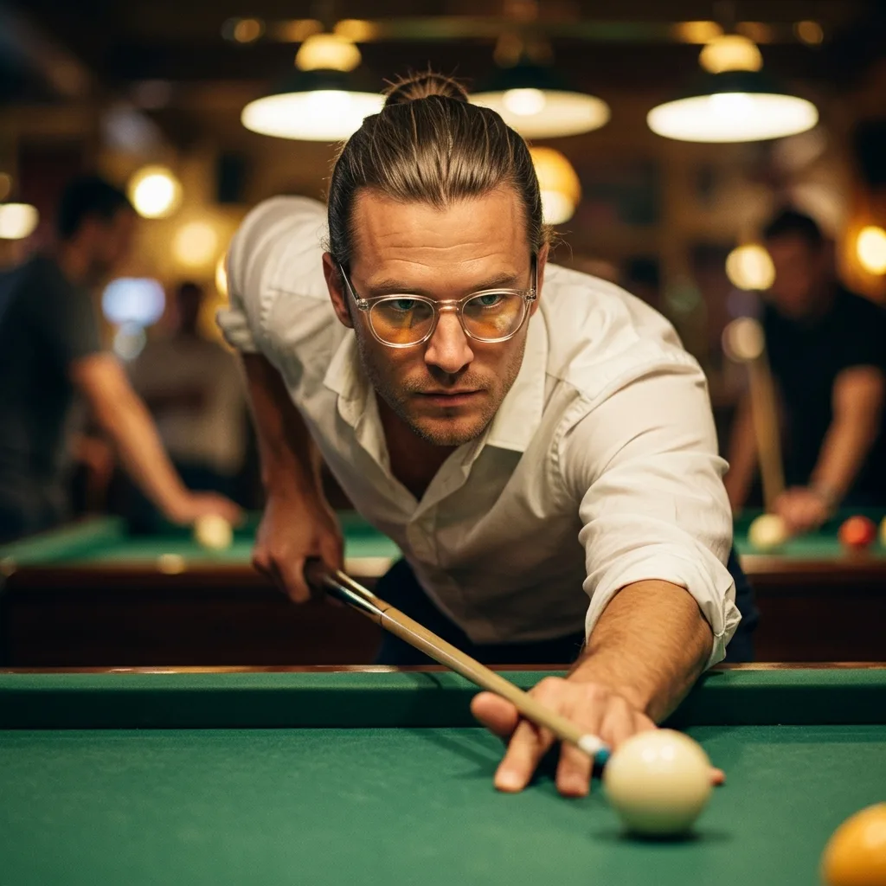

# Close-up of a man taking a billiards shot, captured

[← Back to the collection](../../README.md) · Category: [Photography](../../gallery/photography.md) · Model: `Vinano Image v2` · ID: `vn-00317`

<a href="https://vinano.ai?utm_source=github&utm_medium=readme&utm_campaign=awesome-image-video-prompts-updating&utm_content=prompt-page-image"></a>

<sub>Preview generated with <a href="https://vinano.ai?utm_source=github&utm_medium=readme&utm_campaign=awesome-image-video-prompts-updating&utm_content=prompt-page-caption">vinano.ai</a></sub>

## Prompt

```text
Cinematic ultra-realistic close-up of a man taking a billiards shot, captured in a tense, mid-focus moment as he leans low toward the cue ball. His eyes are locked sharply on the aim, expression steady and confident, while his supporting hand rests firmly on the green felt, guiding the cue precision. He wears a crisp white shirt rolled sleeves and slightly open buttons, giving a relaxed yet intensely focused vibe. His hair is neatly tied back, and his clear-framed glasses catch warm reflections from overhead lights. The background is softly blurred, filled atmospheric golden highlights, adding depth, drama, and a competitive mood to the scene.

use face reference exactly

Preserve realistic proportions and depth for a confident, professional finish.
```

## Try it on vinano.ai

1. Copy the prompt above.
2. Open **[vinano.ai](https://vinano.ai?utm_source=github&utm_medium=readme&utm_campaign=awesome-image-video-prompts-updating&utm_content=prompt-page-try)**, paste it into the image generator and pick a model.
3. Swap any placeholders (brand, product, city, person…) for your own details, then generate.

More prompts like this: [Photography gallery](../../gallery/photography.md) · [all categories](../../README.md#contents)
