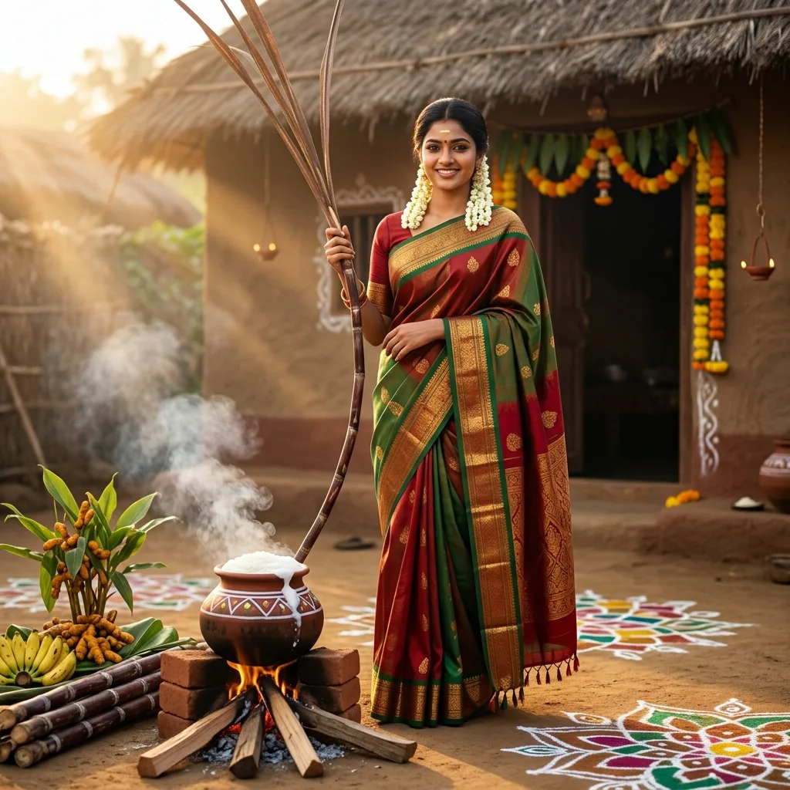

# Uploaded reference image, generate a highly realistic full-body portrait

[← Back to the collection](../../README.md) · Category: [Photography](../../gallery/photography.md) · Model: `Vinano Image Pro` · ID: `vn-00318`

<a href="https://vinano.ai?utm_source=github&utm_medium=readme&utm_campaign=awesome-image-video-prompts-updating&utm_content=prompt-page-image"></a>

<sub>Preview generated with <a href="https://vinano.ai?utm_source=github&utm_medium=readme&utm_campaign=awesome-image-video-prompts-updating&utm_content=prompt-page-caption">vinano.ai</a></sub>

## Prompt

```text
{
 "prompt": " the uploaded reference image, generate a highly realistic full-body portrait of the SAME person 100% identical facial structure, skin tone, facial proportions, and overall identity. Do NOT alter the face in any way.\n\nA proud South Indian woman celebrating the Thaipongal festival, standing gracefully in a traditional rural Tamil village courtyard at sunrise. She is wearing an elegant traditional silk saree (Kanjivaram-style) in rich festive colors a gold zari border, draped authentically. A matching blouse complements the saree. Her hair is neatly styled in a traditional manner, adorned fresh jasmine flowers (mallipoo). A subtle sandalwood or kumkum tilak is visible on her forehead. She holds a long brown leafy sugarcane stalk gently in one hand.\n\nIn the foreground, a decorated clay Pongal pot is boiling over on a wood-fired brick stove, rice frothing out, symbolizing prosperity. Beside the stove are tied brown sugarcane stalks, fresh turmeric plants, bananas, and intricate colorful kolam (rangoli) designs drawn on the ground.\n\nThe background features a rustic mud house a thatched roof, decorated mango-leaf torans, marigold flower garlands, and hanging clay oil lamps. Warm golden sunrise light fills the scene, soft smoke rising from firewood, creating a joyful and auspicious festive atmosphere.\n\nUltra-realistic filmic, cinematic lighting, shallow depth of field, natural South Indian skin texture, authentic Tamil rural aesthetic, 8K ultra-detailed quality, vertical composition, cultural accuracy, festive mood.",
 "style": "cinematic realism, South Indian traditional portrait",
 "lighting": "warm golden sunrise light, soft cinematic glow",
 "environment": "traditional Tamil rural village courtyard",
 "camera": "professional portrait photography, shallow depth of field",
 "quality": "ultra-realistic, 8K, highly detailed",
 "composition": "full-body, vertical frame",
 "constraints": "face must remain 100% identical to the uploaded reference image absolutely no facial modification"
}

Aim for an editorial, design-driven look with deliberate negative space.
```

## Try it on vinano.ai

1. Copy the prompt above.
2. Open **[vinano.ai](https://vinano.ai?utm_source=github&utm_medium=readme&utm_campaign=awesome-image-video-prompts-updating&utm_content=prompt-page-try)**, paste it into the image generator and pick a model.
3. Swap any placeholders (brand, product, city, person…) for your own details, then generate.

More prompts like this: [Photography gallery](../../gallery/photography.md) · [all categories](../../README.md#contents)
