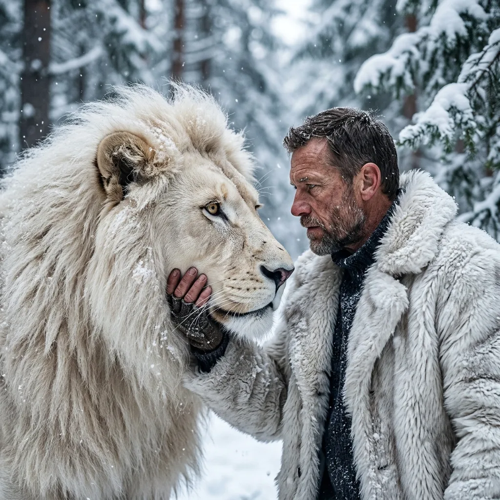

# Portrait of a man standing face-to-face a majestic white

[← Back to the collection](../../README.md) · Category: [Photography](../../gallery/photography.md) · Model: `Vinano Image v2` · ID: `vn-00323`

<a href="https://vinano.ai?utm_source=github&utm_medium=readme&utm_campaign=awesome-image-video-prompts-updating&utm_content=prompt-page-image"></a>

<sub>Preview generated with <a href="https://vinano.ai?utm_source=github&utm_medium=readme&utm_campaign=awesome-image-video-prompts-updating&utm_content=prompt-page-caption">vinano.ai</a></sub>

## Prompt

```text
A cinematic ultra-realistic portrait of a man standing face-to-face a majestic white lion in a snowy forest. The man is wearing a luxurious white fur coat, gently holding the lion’s face one hand, conveying trust, power, and calm dominance. Soft snowfall surrounds them, frosted pine trees blurred in the background. Dramatic natural lighting, shallow depth of field, sharp focus on facial details and fur texture. Cold winter color grading, soft whites and muted grays. Hyper-detailed fur, realistic skin texture, emotional eye contact. Shot on a high-end DSLR, 85mm lens, f/1.8, cinematic composition, true-to-life photorealistic, 8K quality. Preserve realistic proportions and depth for a confident, professional finish.
```

## Try it on vinano.ai

1. Copy the prompt above.
2. Open **[vinano.ai](https://vinano.ai?utm_source=github&utm_medium=readme&utm_campaign=awesome-image-video-prompts-updating&utm_content=prompt-page-try)**, paste it into the image generator and pick a model.
3. Swap any placeholders (brand, product, city, person…) for your own details, then generate.

More prompts like this: [Photography gallery](../../gallery/photography.md) · [all categories](../../README.md#contents)
