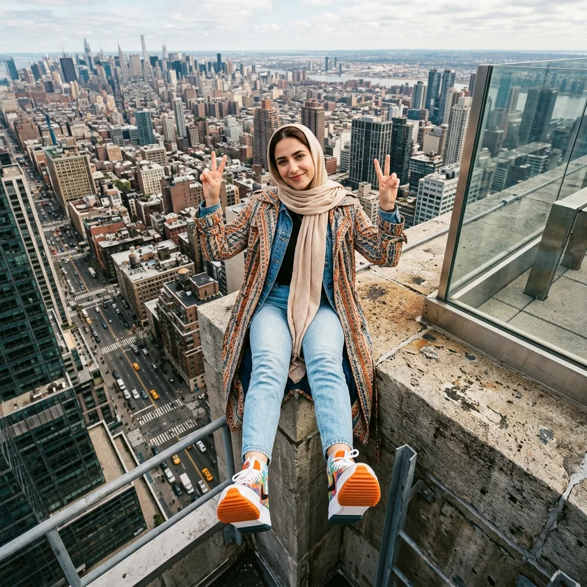

# Young woman sitting at the edge of a skyscraper

[← Back to the collection](../../README.md) · Category: [Photography](../../gallery/photography.md) · Model: `Vinano Image v2` · ID: `vn-00337`

<a href="https://vinano.ai?utm_source=github&utm_medium=readme&utm_campaign=awesome-image-video-prompts-updating&utm_content=prompt-page-image"></a>

<sub>Preview generated with <a href="https://vinano.ai?utm_source=github&utm_medium=readme&utm_campaign=awesome-image-video-prompts-updating&utm_content=prompt-page-caption">vinano.ai</a></sub>

## Prompt

```text
{
 "image_generation": {
 "subject": {
 "description": "young woman sitting at the edge of a skyscraper rooftop a dramatic city view below",
 "pose": "sitting legs extended toward the camera, both hands raised making peace signs",
 "expression": "playful confident smile",
 "gaze": "looking directly at the camera"
 },
 "appearance": {
 "hair": {
 "color": "dark brown",
 "style": "covered a light beige headscarf flowing in the wind"
 },
 "skin": {
 "tone": "fair natural skin tone",
 "texture": "smooth realistic skin"
 },
 "makeup": "light natural makeup"
 },
 "outfit": {
 "outerwear": "long patterned coat",
 "inner_layer": "black top denim jacket",
 "bottom": "light blue jeans",
 "footwear": "colorful sneakers orange soles"
 },
 "environment": {
 "setting": "urban city high-rise rooftop",
 "background_elements": ["busy city street far below",
 "cars and taxis on the road",
 "tall buildings on both sides",
 "glass rooftop surface"],
 "time_of_day": "daytime"
 },
 "lighting": {
 "type": "natural daylight",
 "direction": "soft overhead light",
 "effect": "bright urban lighting balanced shadows"
 },
 "camera": {
 "angle": "extreme high angle / top-down perspective",
 "framing": "full body exaggerated perspective",
 "lens": "wide-angle lens",
 "depth_of_field": "deep focus showing detailed city below"
 },
 "aesthetic": {
 "style": "urban lifestyle photography",
 "vibe": "adventurous bold city energy",
 "color_palette": "vibrant city tones pops of orange and blue"
 },
 "effects": {
 "grading": "cinematic vibrant color grading",
 "sharpness": "high detail slight depth exaggeration"
 },
 "quality": {
 "resolution": "high resolution",
 "render": "true-to-life photorealistic",
 "details": "sharp textures strong perspective depth"
 }
 }
}

Emphasise material texture and natural light so the final frame feels tactile and premium.
```

## Try it on vinano.ai

1. Copy the prompt above.
2. Open **[vinano.ai](https://vinano.ai?utm_source=github&utm_medium=readme&utm_campaign=awesome-image-video-prompts-updating&utm_content=prompt-page-try)**, paste it into the image generator and pick a model.
3. Swap any placeholders (brand, product, city, person…) for your own details, then generate.

More prompts like this: [Photography gallery](../../gallery/photography.md) · [all categories](../../README.md#contents)
