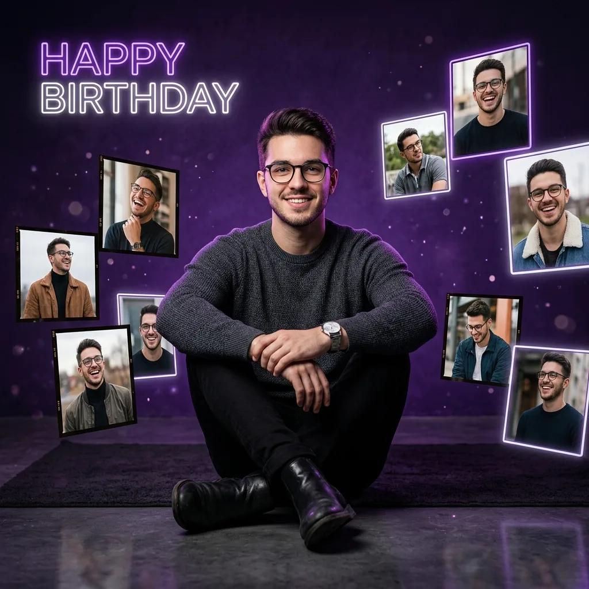

# Subtle glowing particles floating in the background

[← Back to the collection](../../README.md) · Category: [Photography](../../gallery/photography.md) · Model: `Vinano Image Pro` · ID: `vn-00338`

<a href="https://vinano.ai?utm_source=github&utm_medium=readme&utm_campaign=awesome-image-video-prompts-updating&utm_content=prompt-page-image"></a>

<sub>Preview generated with <a href="https://vinano.ai?utm_source=github&utm_medium=readme&utm_campaign=awesome-image-video-prompts-updating&utm_content=prompt-page-caption">vinano.ai</a></sub>

## Prompt

```text
{
 "Objective": "Create a stylish, cinematic birthday-themed studio portrait a modern celebratory poster aesthetic",
 "PersonaDetails": {
 "Subject": {
 "Type": "Young man",
 "Pose": "Sitting casually on the floor",
 "Expression": "Confident, friendly smile",
 "Gaze": "Looking directly at the camera",
 "Accessories": ["Glasses",
 "Wristwatch"]
 }
 },
 "Wardrobe": {
 "Top": "Dark grey sweater",
 "Bottom": "Black trousers",
 "Footwear": "Black leather boots",
 "Style": "Clean, modern, understated"
 },
 "SceneDescription": {
 "Environment": "Studio setting",
 "Background": {
 "Color": "Deep purple",
 "Details": "Subtle glowing particles floating in the background"
 }
 },
 "GraphicElements": {
 "Typography": {
 "Text": "Happy Birthday",
 "Style": "Neon typography",
 "Color": "Soft purple and white glow",
 "Placement": "Top corner of the composition"
 },
 "FloatingFrames": {
 "Description": "Multiple framed portrait snapshots of the same person",
 "Variations": ["Different poses and moods",
 "Film negative–style frames",
 "Neon-outlined light frames"],
 "Arrangement": "Floating around the subject balanced spacing"
 }
 },
 "Composition": {
 "Framing": "Medium full-body portrait",
 "Layout": "Centered subject surrounding floating elements",
 "Balance": "Clean, poster-style composition",
 "DepthOfField": "Shallow depth of field layered depth"
 },
 "LightingAndColor": {
 "LightingStyle": "Cinematic studio lighting",
 "RimLight": "Soft purple rim light for edge separation",
 "Contrast": "High contrast controlled highlights",
 "ColorPalette": ["Deep purple",
 "Black",
 "Soft white highlights"]
 },
 "ArtDirection": {
 "Style": "Modern celebratory poster",
 "Aesthetic": "Stylish, cinematic, social-media–ready",
 "DetailLevel": "Ultra-detailed textures and crisp edges",
 "RealismLevel": "true-to-life photorealistic graphic design overlays"
 },
 "PhotographyStyle": {
 "Genre": "Professional studio portrait photography",
 "Finish": "High-end, polished, digital poster look",
 "Resolution": "Ultra-high resolution, sharp focus"
 },
 "Mood": {
 "Tone": "Celebratory, confident, modern",
 "Energy": "Positive, stylish, personal"
 },
 "NegativePrompt": ["messy composition",
 "low resolution",
 "flat lighting",
 "oversaturated neon",
 "cartoon style",
 "blurry text",
 "cluttered background"],
 "ResponseFormat": {
 "Type": "Single composite image",
 "Orientation": "Portrait",
 "AspectRatio": "4:5",
 "UseCase": ["Social media post",
 "Birthday poster",
 "Digital celebration graphic"]
 }
}

Keep edges clean and the overall composition balanced for a polished, gallery-ready result.
```

## Try it on vinano.ai

1. Copy the prompt above.
2. Open **[vinano.ai](https://vinano.ai?utm_source=github&utm_medium=readme&utm_campaign=awesome-image-video-prompts-updating&utm_content=prompt-page-try)**, paste it into the image generator and pick a model.
3. Swap any placeholders (brand, product, city, person…) for your own details, then generate.

More prompts like this: [Photography gallery](../../gallery/photography.md) · [all categories](../../README.md#contents)
