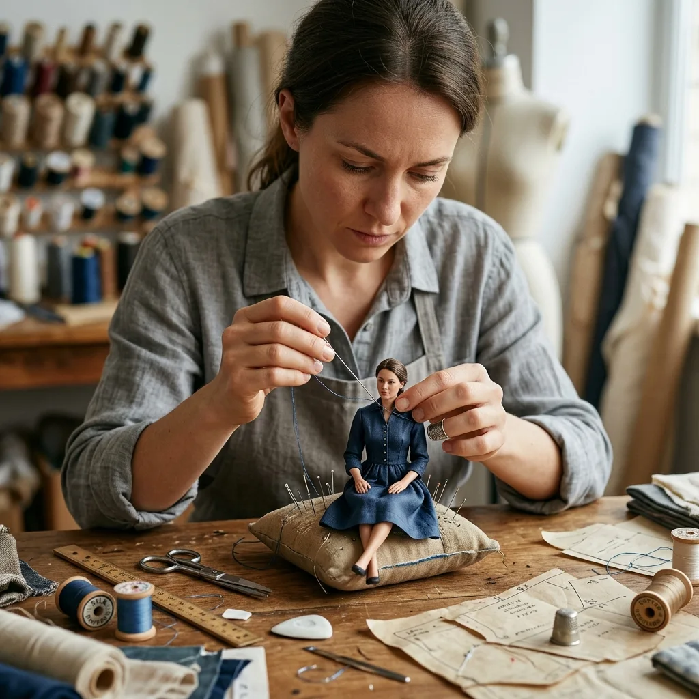

# Fashion studio scene of a woman hand-sewing a miniature

[← Back to the collection](../../README.md) · Category: [Photography](../../gallery/photography.md) · Model: `Vinano Image v2` · ID: `vn-00343`

<a href="https://vinano.ai?utm_source=github&utm_medium=readme&utm_campaign=awesome-image-video-prompts-updating&utm_content=prompt-page-image"></a>

<sub>Preview generated with <a href="https://vinano.ai?utm_source=github&utm_medium=readme&utm_campaign=awesome-image-video-prompts-updating&utm_content=prompt-page-caption">vinano.ai</a></sub>

## Prompt

```text
A cinematic fashion studio scene of a woman hand-sewing a miniature dress worn by a tiny version of herself seated on a pin cushion.
She uses a fine needle and silk thread, concentrating intensely as fabric tension is adjusted.
The miniature garment features perfectly scaled seams, buttons, and lifelike fabric weight in it.
Workbench filled miniature scissors, chalk, rulers, pattern papers, and thread reels.
Warm filmic, cinematic lighting reveals textile grain, skin pores, and metal reflections.
Macro depth of field, fashion editorial composition, ultra-photoreal realism, 8K quality.

Style: cinematic miniature tailoring realism, no cartoon, no CGI

Maintain consistent colour harmony and crisp focus across the whole frame.
```

## Try it on vinano.ai

1. Copy the prompt above.
2. Open **[vinano.ai](https://vinano.ai?utm_source=github&utm_medium=readme&utm_campaign=awesome-image-video-prompts-updating&utm_content=prompt-page-try)**, paste it into the image generator and pick a model.
3. Swap any placeholders (brand, product, city, person…) for your own details, then generate.

More prompts like this: [Photography gallery](../../gallery/photography.md) · [all categories](../../README.md#contents)
