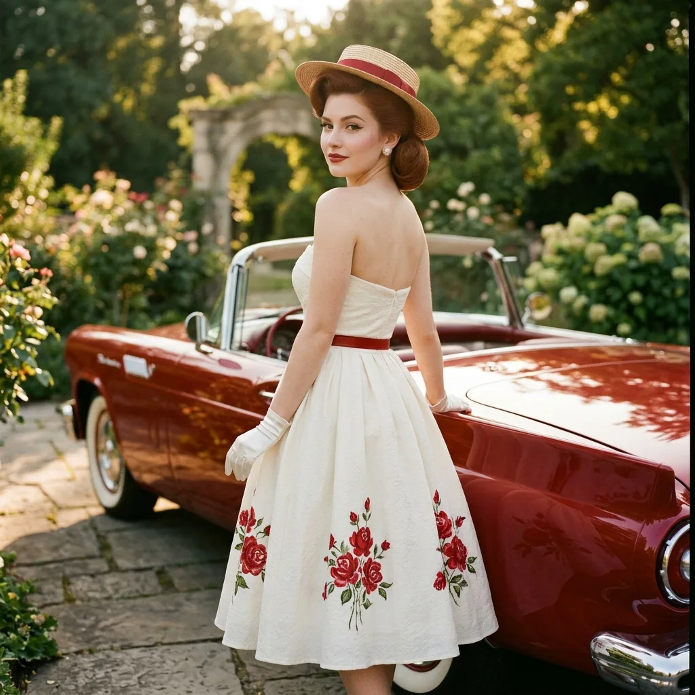

# Vintage fashion portrait of a graceful young woman

[← Back to the collection](../../README.md) · Category: [Photography](../../gallery/photography.md) · Model: `Vinano Image v2` · ID: `vn-00350`

<a href="https://vinano.ai?utm_source=github&utm_medium=readme&utm_campaign=awesome-image-video-prompts-updating&utm_content=prompt-page-image"></a>

<sub>Preview generated with <a href="https://vinano.ai?utm_source=github&utm_medium=readme&utm_campaign=awesome-image-video-prompts-updating&utm_content=prompt-page-caption">vinano.ai</a></sub>

## Prompt

```text
A cinematic vintage fashion portrait of a graceful young woman in a 1950s aesthetic, standing beside a classic convertible car. She is captured from a three-quarter back angle, looking over her shoulder a soft, confident gaze. She wears an elegant ivory strapless dress a fitted bodice and a flowing skirt adorned hand-painted red rose floral patterns near the hem. A thin red belt cinches her waist. Her hair is styled in a voluminous retro updo, auburn/red tones, topped a straw boater hat featuring a red ribbon. She wears white satin gloves and delicate pearl earrings. Makeup is refined and timeless: winged eyeliner, soft blush, and deep red lipstick. The scene is bathed in warm golden-hour sunlight creamy bokeh in the background, outdoor garden setting. Ultra-detailed, true-to-life photorealistic, shallow depth of field, filmic, cinematic lighting, luxury fashion editorial style, 8K quality. Render with rich micro-detail while keeping the layout uncluttered and intentional.
```

## Try it on vinano.ai

1. Copy the prompt above.
2. Open **[vinano.ai](https://vinano.ai?utm_source=github&utm_medium=readme&utm_campaign=awesome-image-video-prompts-updating&utm_content=prompt-page-try)**, paste it into the image generator and pick a model.
3. Swap any placeholders (brand, product, city, person…) for your own details, then generate.

More prompts like this: [Photography gallery](../../gallery/photography.md) · [all categories](../../README.md#contents)
