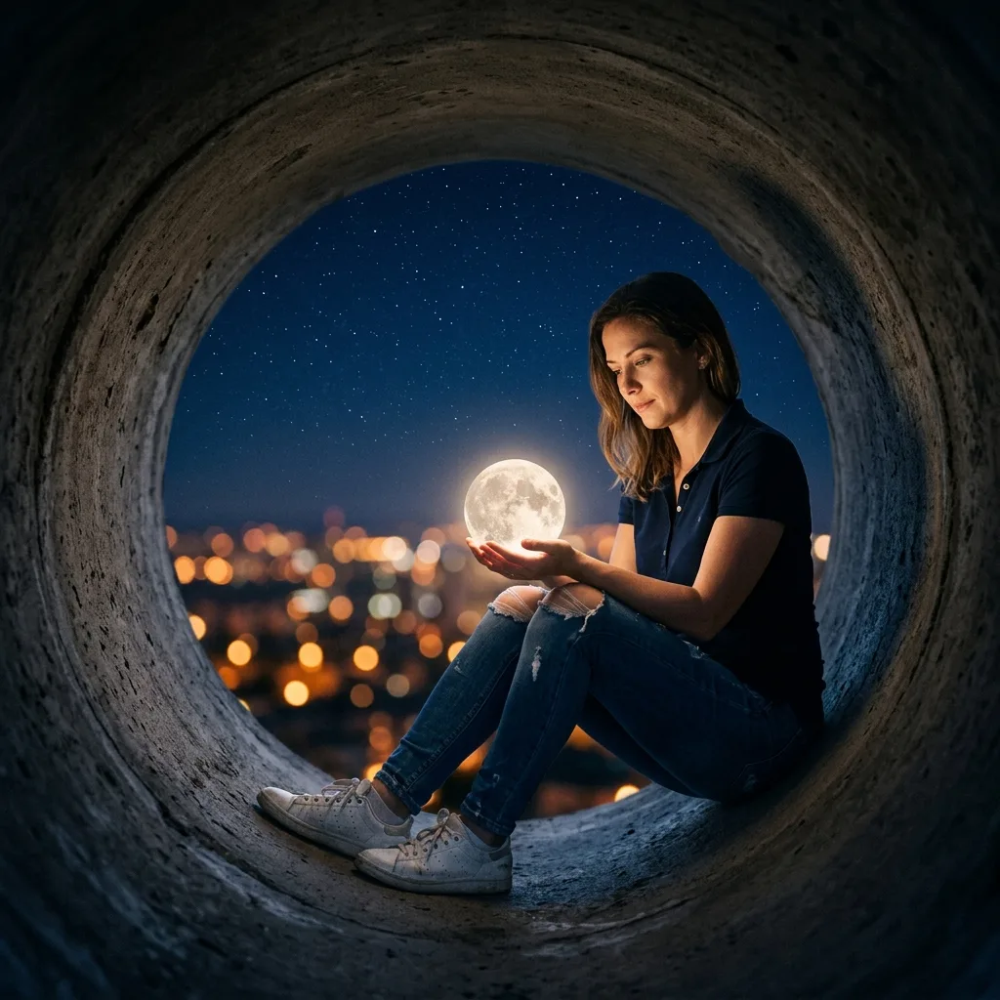

# Surreal photography of a woman sitting inside a massive

[← Back to the collection](../../README.md) · Category: [Photography](../../gallery/photography.md) · Model: `Vinano Image v2` · ID: `vn-00352`

<a href="https://vinano.ai?utm_source=github&utm_medium=readme&utm_campaign=awesome-image-video-prompts-updating&utm_content=prompt-page-image"></a>

<sub>Preview generated with <a href="https://vinano.ai?utm_source=github&utm_medium=readme&utm_campaign=awesome-image-video-prompts-updating&utm_content=prompt-page-caption">vinano.ai</a></sub>

## Prompt

```text
Hyper-realistic surreal photography of a woman sitting inside a massive, rough concrete pipe, featuring the uploaded face as reference. She wears a dark polo shirt, ripped jeans, and white sneakers, a calm and thoughtful expression. She is gently holding a glowing, miniature full moon in her cupped hands. The surreal moon casts a warm, magical rim light across her face and body. The camera is positioned from inside the pipe, creating a natural circular frame around her. In the background, a starry night sky is visible along a deeply blurred cityscape filled warm orange bokeh lights. Shot a 50mm lens, shallow depth of field, high contrast, blending cool night tones the ethereal glow of the moon in her hands. Emphasise material texture and natural light so the final frame feels tactile and premium.
```

## Try it on vinano.ai

1. Copy the prompt above.
2. Open **[vinano.ai](https://vinano.ai?utm_source=github&utm_medium=readme&utm_campaign=awesome-image-video-prompts-updating&utm_content=prompt-page-try)**, paste it into the image generator and pick a model.
3. Swap any placeholders (brand, product, city, person…) for your own details, then generate.

More prompts like this: [Photography gallery](../../gallery/photography.md) · [all categories](../../README.md#contents)
