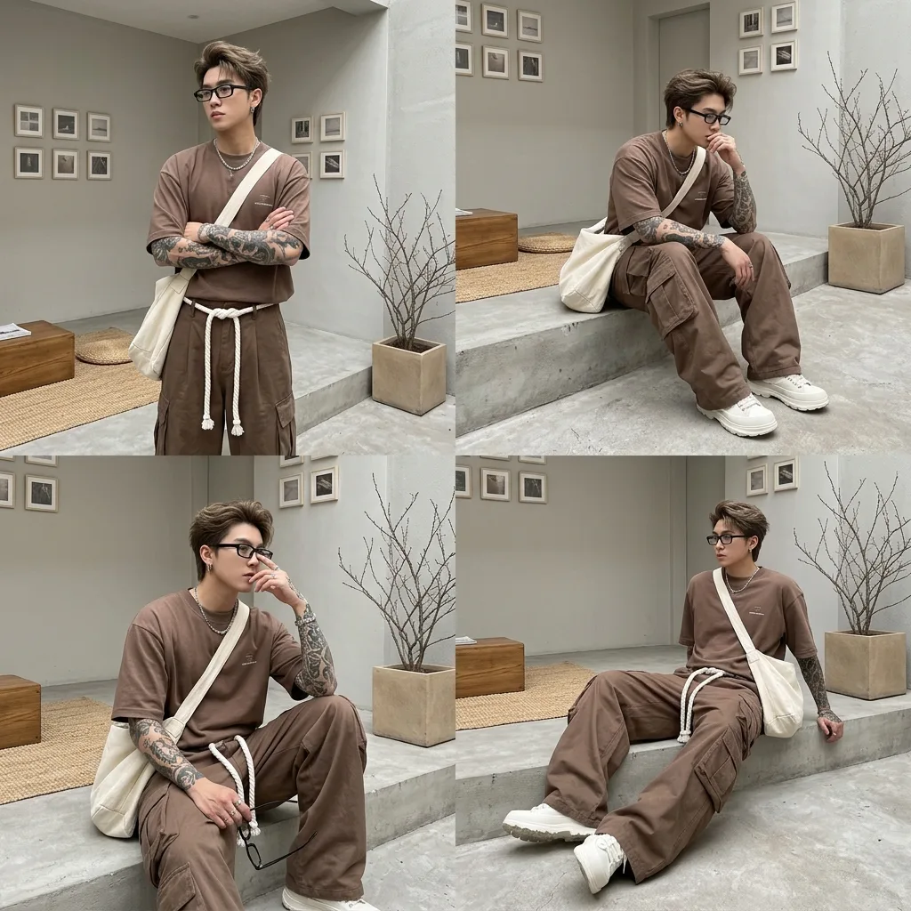

# Transform this image UPLOAD YOU'RE IMAGE into a 64K

[← Back to the collection](../../README.md) · Category: [Photography](../../gallery/photography.md) · Model: `Vinano Image Pro` · ID: `vn-00353`

<a href="https://vinano.ai?utm_source=github&utm_medium=readme&utm_campaign=awesome-image-video-prompts-updating&utm_content=prompt-page-image"></a>

<sub>Preview generated with <a href="https://vinano.ai?utm_source=github&utm_medium=readme&utm_campaign=awesome-image-video-prompts-updating&utm_content=prompt-page-caption">vinano.ai</a></sub>

## Prompt

```text
Transform this image [UPLOAD YOU'RE IMAGE] into a 64K DSLR shot resolution of A four-panel fashion collage featuring the same subject styled in a cohesive earth-tone, refined minimalist streetwear aesthetic, photographed in a calm, modern concrete courtyard or interior patio space. The environment is muted and serene, light gray walls, raw cement flooring, and subtle natural decor elements that enhance the understated mood. The subject (sameface as the uploaded image) is a athletic build, androgynous-presenting young adult stylish volume hairs and cool, introspective expression. They wear thin black rectangular glasses, silver jewelry (necklace and earrings), and have intricate black-and-gray tattoo sleeves covering the forearms and hands.

Outfit & Styling:-

Oversized brown T-shirt a small minimal chest graphic or letter Extremely baggy brown cargo pants large utility pockets and heavy drapeThick white rope belt tied loosely, hanging dramatically at the waist Chunky white sneakers a bold sole Large off-white canvas shoulder bag worn crossbody, adding texture and contrast The color palette is warm and neutral: browns, taupe, beige, off-white, and soft gray.

Poses Across the Panels:-

Standing arms crossed, relaxed but confident

Sitting on a concrete step, leaning forward in a contemplative pose Seated casually one leg bent, holding

glasses or touching the faceA laid-back pose emphasizing the oversized silhouette and layered textures Background & Props:-

refined minimalist decor including a woven straw mat, a wooden box, and a potted branch arrangement in a square planter Small framed wall art arranged in a clean

grid

Soft natural daylight diffused shadows, no harsh highlights Mood & Aesthetic:- The overall vibe is quiet luxury meets Japanese-inspired minimal streetwear, blending modern fashion, utilitarian design, and calmeditorial styling. The image feels like a fashion lookbook or lifestyle editorial, emphasis on silhouette, texture, and effortless cool.

Style Keywords:- refined minimalist streetwear, neutral tones, oversized fashion, utilitarian cargo pants, androgynous style, editorial fashion collage, modern zen aesthetic, Japanese-inspired fashion, muted color palette.

Keep edges clean and the overall composition balanced for a polished, gallery-ready result.
```

## Try it on vinano.ai

1. Copy the prompt above.
2. Open **[vinano.ai](https://vinano.ai?utm_source=github&utm_medium=readme&utm_campaign=awesome-image-video-prompts-updating&utm_content=prompt-page-try)**, paste it into the image generator and pick a model.
3. Swap any placeholders (brand, product, city, person…) for your own details, then generate.

More prompts like this: [Photography gallery](../../gallery/photography.md) · [all categories](../../README.md#contents)
