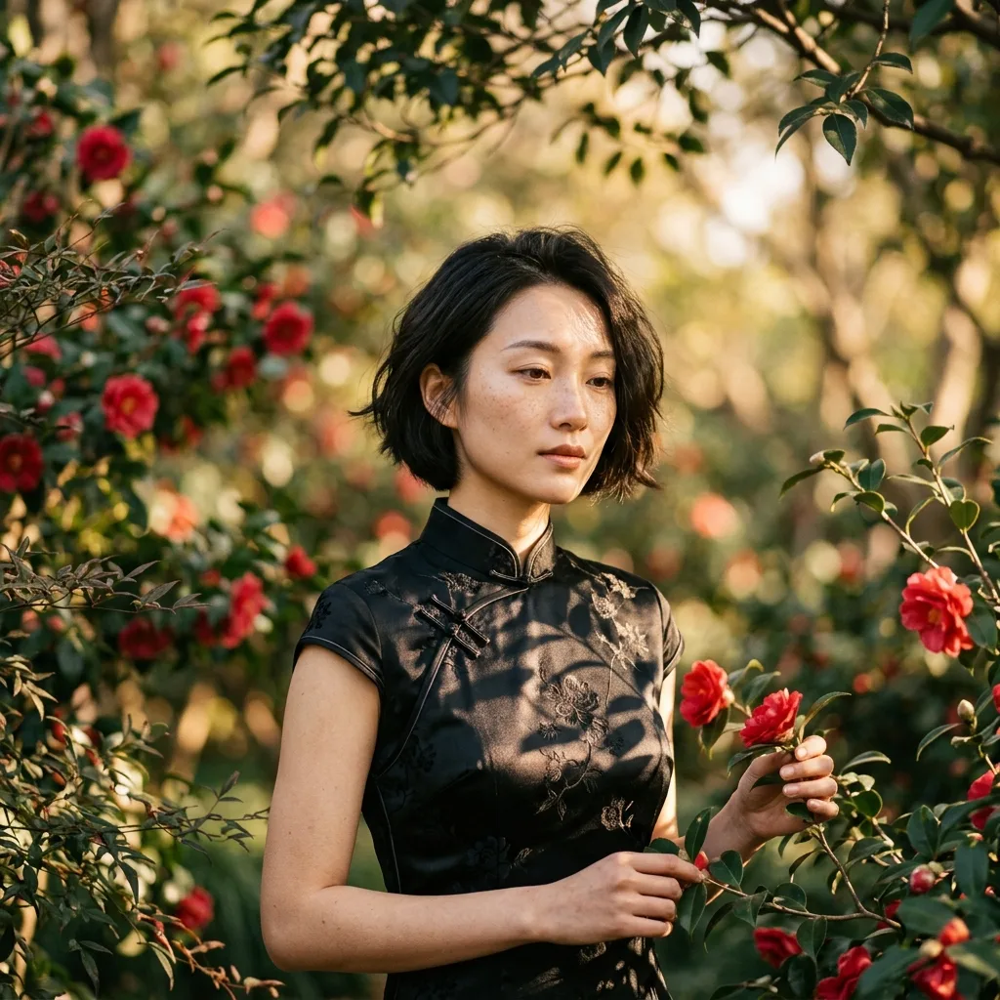

# Artistic portrait of an elegant Asian woman wearing

[← Back to the collection](../../README.md) · Category: [Photography](../../gallery/photography.md) · Model: `Vinano Image v2` · ID: `vn-00354`

<a href="https://vinano.ai?utm_source=github&utm_medium=readme&utm_campaign=awesome-image-video-prompts-updating&utm_content=prompt-page-image"></a>

<sub>Preview generated with <a href="https://vinano.ai?utm_source=github&utm_medium=readme&utm_campaign=awesome-image-video-prompts-updating&utm_content=prompt-page-caption">vinano.ai</a></sub>

## Prompt

```text
Artistic portrait of an elegant Asian woman wearing a black silk cheongsam (qipao), standing among red camellia flowers and delicate branches, soft natural sunlight filtering through leaves creating beautiful shadow patterns across her face, short slightly messy bob haircut, natural freckles and minimal makeup, calm thoughtful expression, cinematic shallow depth of field, dreamy garden atmosphere, warm golden hour lighting, soft bokeh background, fine art photography style, ultra-realistic skin texture, high detail, 85mm lens, 8K. Preserve realistic proportions and depth for a confident, professional finish.
```

## Try it on vinano.ai

1. Copy the prompt above.
2. Open **[vinano.ai](https://vinano.ai?utm_source=github&utm_medium=readme&utm_campaign=awesome-image-video-prompts-updating&utm_content=prompt-page-try)**, paste it into the image generator and pick a model.
3. Swap any placeholders (brand, product, city, person…) for your own details, then generate.

More prompts like this: [Photography gallery](../../gallery/photography.md) · [all categories](../../README.md#contents)
