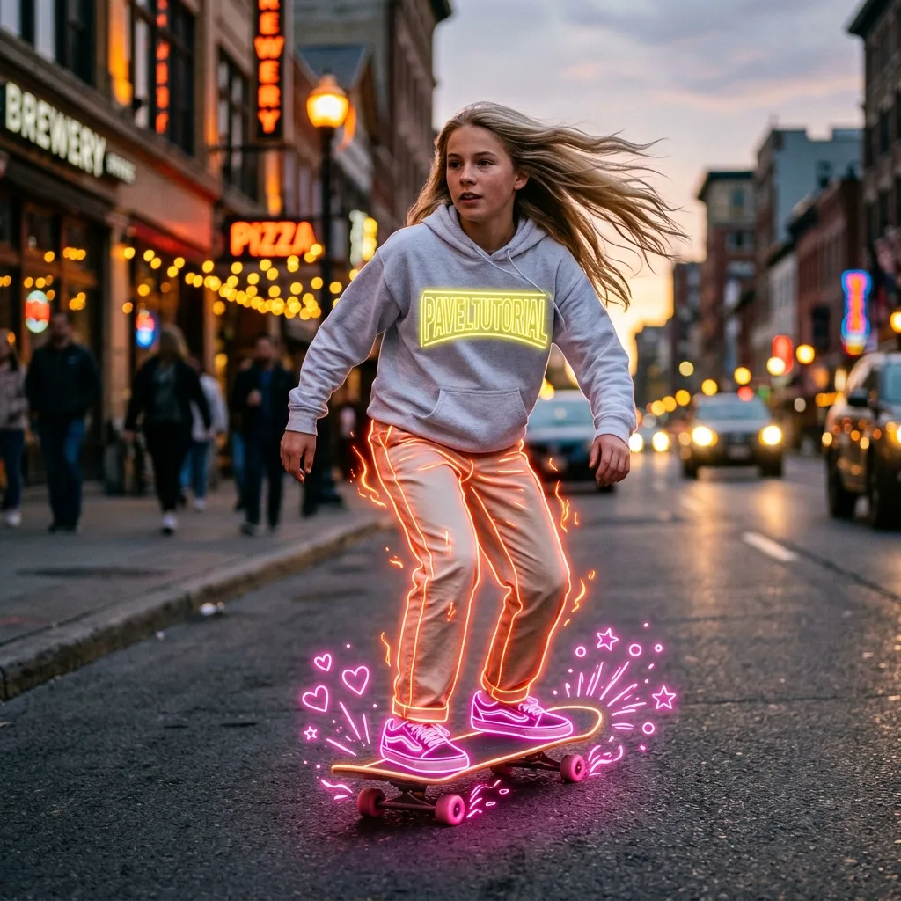

# 8K, MEDIUM SHOT CAPTURED A WIDE-ANGLE LENS

[← Back to the collection](../../README.md) · Category: [Photography](../../gallery/photography.md) · Model: `Vinano Image v2` · ID: `vn-00356`

<a href="https://vinano.ai?utm_source=github&utm_medium=readme&utm_campaign=awesome-image-video-prompts-updating&utm_content=prompt-page-image"></a>

<sub>Preview generated with <a href="https://vinano.ai?utm_source=github&utm_medium=readme&utm_campaign=awesome-image-video-prompts-updating&utm_content=prompt-page-caption">vinano.ai</a></sub>

## Prompt

```text
A HYPER-REALISTIC, 8K, MEDIUM SHOT CAPTURED A WIDE-ANGLE LENS FROM A SLIGHTLY LOW ANGLE SHOWCASING A YOUNG PERSON IN A DYNAMIC, MID-ACTION POSE ON A SKATEBOARD, RIDING DOWN AN URBAN STREET AT DUSK. THE SUBJECT, UPLOADED FACE AS REFERENCE, HAS LONG, LIGHT-COLORED HAIR FLOWING DYNAMICALLY TO THEIR RIGHT, INDICATING MOTION. THEY ARE WEARING A LIGHT GREY OR OFF-WHITE HOODIE FEATURING A PROMINENT, BRIGHT YELLOW HEON OUTLINE GRAPHIC THAT SPELLS "PAVELTUTORIAL ACROSS THE CHEST. THEIR LEGS ARE CLAD IN LIGHT BROWN OR BEIGE PANTS, INTRICATELY OUTLINED A VIBRANT ORANGE-RED NEON GLOW THAT ALSO EMITS SMALL, FLICKERING NEON WISPS AROUND THEM, SUGGESTING ENERGY. THEIR FEET ARE ADORNED BRIGHT PINK NEON-OUTLINED SNEAKERS, WHICH MATCH THE GLOWING PINK OUTLINE OF THE SKATEBOARD DECK BENEATH THEM. AROUND THE SKATEBOARD AND THE SUBJECT'S FEET, THERE ARE WHIMSICAL, GLOWING PINK NEON HEARTS AND STARBURSTS, ADDING A SURREAL, ENERGETIC TOUCH. THE BACKGROUND IS AN URBAN STREET SCENE, RENDERED A SHALLOW DEPTH OF FIELD, CREATING A BEAUTIFUL BOKEH EFFECT OF WARM, OUT-OF-FOCUS ORANGE AND YELLOW STRING LIGHTS STRUNG ACROSS BUILDINGS, SUGGESTING A FESTIVE OR LIVELY ATMOSPHERE. SILHOUETTES OF BLURRED PEDESTRIANS CAN BE SEEN IN THE DISTANCE. THE OVERALL LIGHTING IS CINEMATIC, A SOFT GOLDEN HOUR GLOW FROM THE BACKGROUND CONTRASTING THE VIBRANT. VOLUMETRIC NEON LIGHTING EMANATING FROM THE SUBJECT AND THEIR ACCESSORIES, CREATING HIGHLY

DETAILED TEXTURES AND A CAPTIVATING VISUAL.

Maintain consistent colour harmony and crisp focus across the whole frame.
```

## Try it on vinano.ai

1. Copy the prompt above.
2. Open **[vinano.ai](https://vinano.ai?utm_source=github&utm_medium=readme&utm_campaign=awesome-image-video-prompts-updating&utm_content=prompt-page-try)**, paste it into the image generator and pick a model.
3. Swap any placeholders (brand, product, city, person…) for your own details, then generate.

More prompts like this: [Photography gallery](../../gallery/photography.md) · [all categories](../../README.md#contents)
