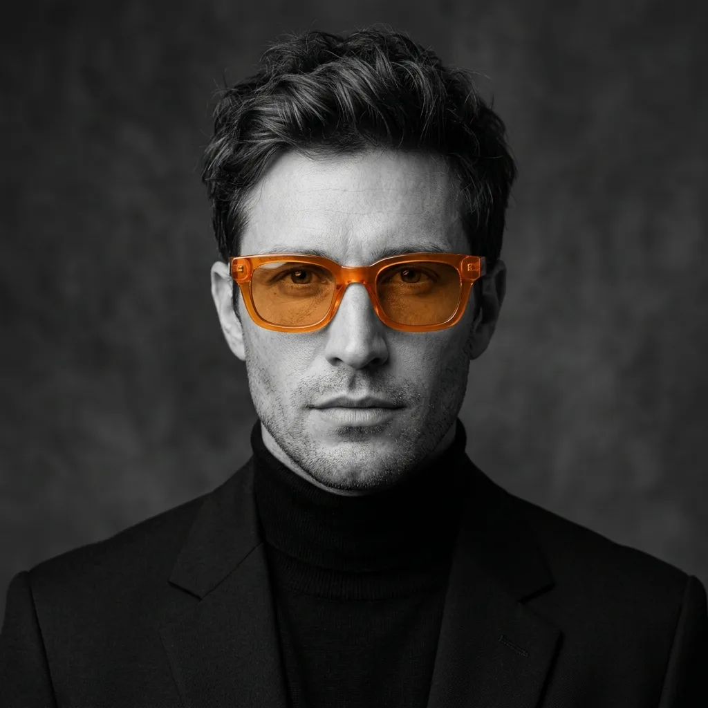

# Close-up studio portrait of me, masculine features, textured messy

[← Back to the collection](../../README.md) · Category: [Photography](../../gallery/photography.md) · Model: `Vinano Image v2` · ID: `vn-00367`

<a href="https://vinano.ai?utm_source=github&utm_medium=readme&utm_campaign=awesome-image-video-prompts-updating&utm_content=prompt-page-image"></a>

<sub>Preview generated with <a href="https://vinano.ai?utm_source=github&utm_medium=readme&utm_campaign=awesome-image-video-prompts-updating&utm_content=prompt-page-caption">vinano.ai</a></sub>

## Prompt

```text
A close-up studio portrait of me, masculine features, textured messy hair neatly styled.
I wear a black tailored blazer sharp structure and clean lines, layered over a black high-neck turtleneck, embodying a refined minimalist and contemporary fashion style.
The man is wearing bold translucent orange acetate sunglasses, rectangular frame slightly rounded edges, glossy finish, amber/orange tinted lenses, and fashion-forward and statement eyewear. Color concept: selective color photography - monochrome black and white image only the sunglasses in vibrant orange color, creating strong contrast and visual focus.
Expression: calm, confident, serious gaze, looking straight into the camera.
Lighting: soft studio lighting from the front subtle side shadows, even skin tones, greath detai,l facial texture, and cinematic contrast. Camera settings:
- Lens: 85mm portrait lens
- Aperture: f/2.0
- ISO: 100
- Shutter speed: 1/125
- High resolution, ultra-sharp focus on face Style: editorial fashion portrait, luxury menswear, realistic skin texture, non-Al look, professional studio photography.

Keep edges clean and the overall composition balanced for a polished, gallery-ready result.
```

## Try it on vinano.ai

1. Copy the prompt above.
2. Open **[vinano.ai](https://vinano.ai?utm_source=github&utm_medium=readme&utm_campaign=awesome-image-video-prompts-updating&utm_content=prompt-page-try)**, paste it into the image generator and pick a model.
3. Swap any placeholders (brand, product, city, person…) for your own details, then generate.

More prompts like this: [Photography gallery](../../gallery/photography.md) · [all categories](../../README.md#contents)
