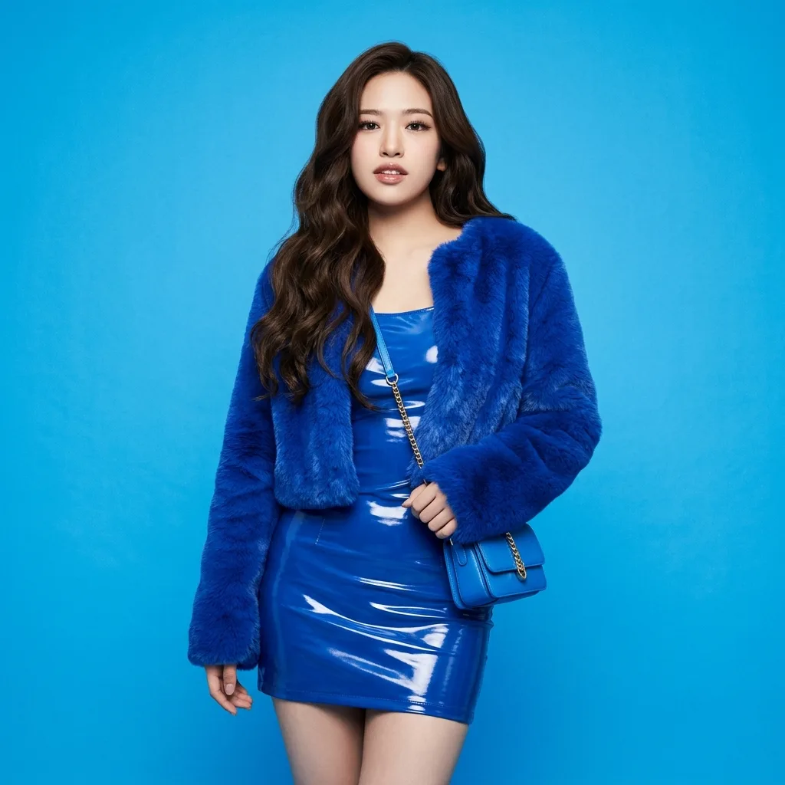

# Ultra-detailed fashion portrait of a beautiful young Korean woman

[← Back to the collection](../../README.md) · Category: [Photography](../../gallery/photography.md) · Model: `Vinano Image v2` · ID: `vn-00368`

<a href="https://vinano.ai?utm_source=github&utm_medium=readme&utm_campaign=awesome-image-video-prompts-updating&utm_content=prompt-page-image"></a>

<sub>Preview generated with <a href="https://vinano.ai?utm_source=github&utm_medium=readme&utm_campaign=awesome-image-video-prompts-updating&utm_content=prompt-page-caption">vinano.ai</a></sub>

## Prompt

```text
{
"prompt": "ultra-detailed fashion portrait of a beautiful young Korean woman, exactly matching An Yujin from IVE, tall athletic elegant figure, standing confidently in a vibrant all-blue studio, wearing a tight glossy blue patent latex bodycon mini dress that hugs every curve, shiny reflective blue vinyl material, deep cobalt blue color, sleeveless square neckline, short length above mid-thigh, layered a luxurious fluffy soft blue faux fur cropped jacket fuzzy long fur texture, open front, long voluminous dark brown hair perfect loose Hollywood waves cascading down to waist, charismatic deep eyes, full glossy nude-pink lips, dramatic makeup long lashes, sharp eyeliner, flawless glowing fair skin, confident seductive expression, slight head tilt, holding a small structured hot blue designer crossbody purse gold chain strap, bright even baby blue background, soft professional studio lighting, high fashion editorial style, hyper-realistic, ultra sharp details, 8k resolution, true-to-life photorealistic skin texture, intricate fur details, reflective latex shine, azurecore aesthetic, maximalist blue glamour, shot on Canon EOS R5, 85mm lens, f/1.8, cinematic color grading",
"negative_prompt": "low quality, blurry, deformed, ugly, extra limbs, bad anatomy, poorly drawn face, bad proportions, watermark, text, logo, cropped, out of frame, skinny, thin body, small chest, flat figure, realistic clothing texture instead of latex, muted colors, dark background, green skin, male",
"parameters": {
"aspect_ratio": "9:16",
"style": "true-to-life photorealistic fashion photography",
"lighting": "soft studio lighting subtle rim light",
"quality_tags": "masterpiece, best quality, ultra detailed, highly detailed, sharp focus",
"sampler": "DPM++ 2M Karras or Euler a",
"steps": 35,
"cfg_scale": 7.5,
"seed": -1
},
"model_recommendations": [" dev",
"Realistic Vision V6.0",
"Juggernaut XL",
"Photon",
""]
}

Preserve realistic proportions and depth for a confident, professional finish.
```

## Try it on vinano.ai

1. Copy the prompt above.
2. Open **[vinano.ai](https://vinano.ai?utm_source=github&utm_medium=readme&utm_campaign=awesome-image-video-prompts-updating&utm_content=prompt-page-try)**, paste it into the image generator and pick a model.
3. Swap any placeholders (brand, product, city, person…) for your own details, then generate.

More prompts like this: [Photography gallery](../../gallery/photography.md) · [all categories](../../README.md#contents)
