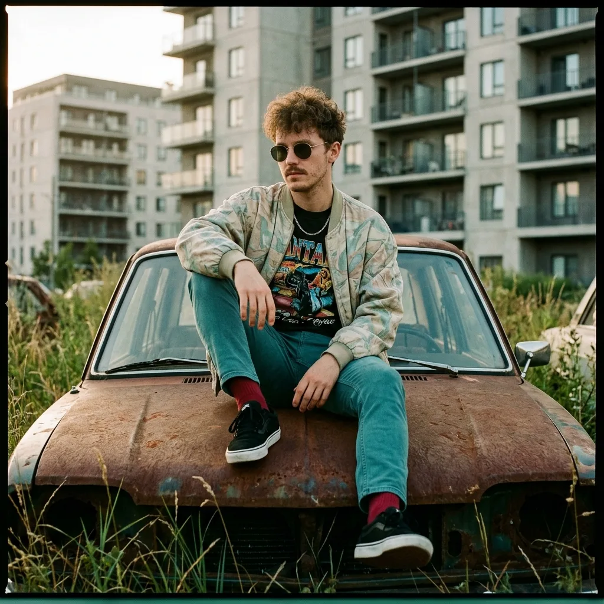

# Sitting casually on the hood of an abandoned car

[← Back to the collection](../../README.md) · Category: [Photography](../../gallery/photography.md) · Model: `Vinano Image v2` · ID: `vn-00370`

<a href="https://vinano.ai?utm_source=github&utm_medium=readme&utm_campaign=awesome-image-video-prompts-updating&utm_content=prompt-page-image"></a>

<sub>Preview generated with <a href="https://vinano.ai?utm_source=github&utm_medium=readme&utm_campaign=awesome-image-video-prompts-updating&utm_content=prompt-page-caption">vinano.ai</a></sub>

## Prompt

```text
{
"composition": {
"framing": "centered subject symmetrical balance",
"perspective": "eye-level, slight downward tilt",
"crop": "vertical portrait orientation, full body seated pose",
"depth_of_field": "moderate, subject sharp softly detailed background",
"leading_elements": "rusted car edges and hood frame the subject"
},
"subject": {
"type": "human",
"pose": "sitting casually on the hood of an abandoned car, one leg bent, one leg hanging",
"expression": "relaxed, confident, contemplative",
"gaze": "looking slightly downward and to the side",
"hair": "short, curly, tousled",
"facial_hair": "light mustache and stubble",
"accessories": ["round sunglasses",
"necklace"]
},
"clothing": {
"outerwear": "patterned bomber jacket muted pastel tones",
"top": "graphic t-shirt colorful print",
"pants": "teal slim-fit jeans, slightly cropped",
"footwear": "black sneakers white soles and red socks"
},
"environment": {
"setting": "urban outdoor area",
"foreground": "overgrown grass and weeds",
"primary_object": "abandoned, heavily rusted vintage car",
"background": "modern apartment buildings balconies",
"contrast": "decay versus modern urban living"
},
"color_palette": {
"dominant_colors": ["rust red",
"teal",
"muted green",
"beige",
"brown"],
"accent_colors": ["red",
"yellow",
"black"],
"color_temperature": "warm teal-green shadows",
"grading_style": "cinematic, desaturated highlights, rich shadows"
},
"lighting": {
"type": "natural light",
"time_of_day": "late afternoon or golden hour",
"direction": "side-lit soft shadows",
"contrast": "medium contrast",
"highlights": "soft and warm on skin and metal surfaces"
},
"technical_details": {
"camera_type": "DSLR or mirrorless",
"lens_estimate": "35mm–50mm prime",
"aperture_estimate": "f/2.8–f/4",
"iso_estimate": "ISO 200–400",
"shutter_speed_estimate": "1/200–1/400",
"focus": "sharp on subject, slightly softer background"
},
"artistic_style": {
"genre": "urban lifestyle portrait",
"mood": "nostalgic, gritty, stylish",
"influences": ["street photography",
"cinematic editorial fashion"],
"texture": "visible grain, emphasis on rust and fabric detail"
},
"post_processing": {
"grain": "moderate film grain",
"sharpening": "selective sharpening on subject",
"contrast_curve": "soft highlights lifted blacks",
"vignette": "subtle vignette around edges"
},
"background_details": {
"architecture": "concrete apartment blocks repetitive windows",
"color": "neutral beige and gray tones",
"blur_level": "light background separation without heavy bokeh"
},
"overall_aesthetic": {
"theme": "urban decay meets modern fashion",
"visual_story": "individuality and style emerging from neglected environments",
"use_case": ["editorial fashion",
"UGC influencer content",
"cinematic portrait reference"]
}
}

Preserve realistic proportions and depth for a confident, professional finish.
```

## Try it on vinano.ai

1. Copy the prompt above.
2. Open **[vinano.ai](https://vinano.ai?utm_source=github&utm_medium=readme&utm_campaign=awesome-image-video-prompts-updating&utm_content=prompt-page-try)**, paste it into the image generator and pick a model.
3. Swap any placeholders (brand, product, city, person…) for your own details, then generate.

More prompts like this: [Photography gallery](../../gallery/photography.md) · [all categories](../../README.md#contents)
