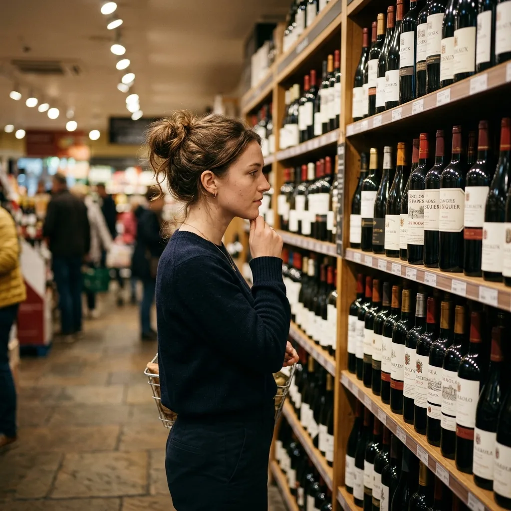

# Side-profile portrait of a young woman standing

[← Back to the collection](../../README.md) · Category: [Photography](../../gallery/photography.md) · Model: `Vinano Image v2` · ID: `vn-00374`

<a href="https://vinano.ai?utm_source=github&utm_medium=readme&utm_campaign=awesome-image-video-prompts-updating&utm_content=prompt-page-image"></a>

<sub>Preview generated with <a href="https://vinano.ai?utm_source=github&utm_medium=readme&utm_campaign=awesome-image-video-prompts-updating&utm_content=prompt-page-caption">vinano.ai</a></sub>

## Prompt

```text
A cinematic side-profile portrait of a young woman standing in a grocery store aisle, carefully looking at a shelf filled wine bottles. She has her hair tied in a loose messy bun and wears a simple dark outfit. The environment is softly lit warm indoor lighting, creating a cozy, realistic atmosphere. The shelves are filled neatly arranged bottles, while other shoppers appear blurred in the background. Shallow depth of field strong foreground and background blur, creamy bokeh lights, natural skin tones, documentary-style photography, candid moment, 50mm lens, f/1.8, ultra-realistic detail, cinematic color grading, 8K. Emphasise material texture and natural light so the final frame feels tactile and premium.
```

## Try it on vinano.ai

1. Copy the prompt above.
2. Open **[vinano.ai](https://vinano.ai?utm_source=github&utm_medium=readme&utm_campaign=awesome-image-video-prompts-updating&utm_content=prompt-page-try)**, paste it into the image generator and pick a model.
3. Swap any placeholders (brand, product, city, person…) for your own details, then generate.

More prompts like this: [Photography gallery](../../gallery/photography.md) · [all categories](../../README.md#contents)
