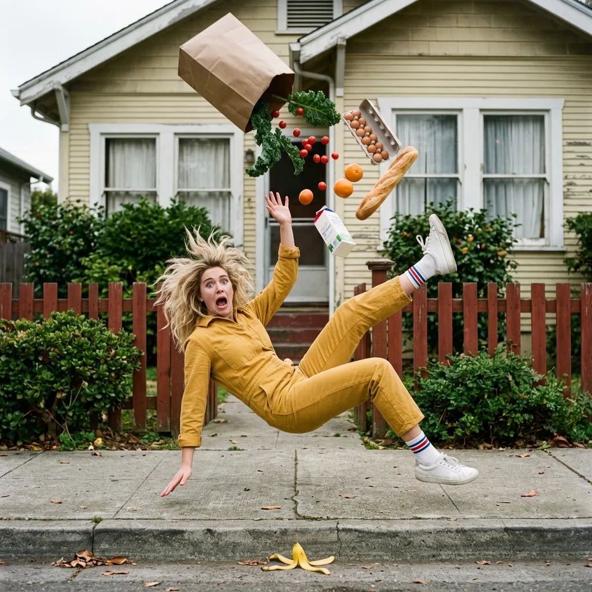

# Blonde hair mid-motion, slightly messy, expressive shocked face wide

[← Back to the collection](../../README.md) · Category: [Photography](../../gallery/photography.md) · Model: `Vinano Image v2` · ID: `vn-00382`

<a href="https://vinano.ai?utm_source=github&utm_medium=readme&utm_campaign=awesome-image-video-prompts-updating&utm_content=prompt-page-image"></a>

<sub>Preview generated with <a href="https://vinano.ai?utm_source=github&utm_medium=readme&utm_campaign=awesome-image-video-prompts-updating&utm_content=prompt-page-caption">vinano.ai</a></sub>

## Prompt

```text
{
"style": "cinematic realism, surreal moment frozen in time",
"scene": "a suburban street in front of an old slightly worn house muted yellow walls, white window frames, and a red wooden fence, overcast daylight soft diffused lighting",
"subject": {
"type": "young woman",
"appearance": "blonde hair mid-motion, slightly messy, expressive shocked face wide eyes and open mouth",
"outfit": "mustard yellow jumpsuit, white socks stripes, white sneakers",
"pose": "falling backward in mid-air, body tilted diagonally, one leg raised high, arms flailing for balance",
"emotion": "surprised, chaotic, comedic panic"
},
"action": "a grocery bag has exploded mid-air, items floating above her as if gravity paused for a split second",
"objects": {
"floating_items": ["brown paper grocery bag",
"kale leaves",
"cherry tomatoes",
"oranges",
"egg carton",
"baguette bread",
"milk carton"],
"ground_element": "a banana peel on the sidewalk directly below her, implying the cause of the fall"
},
"environment": {
"foreground": "concrete sidewalk subtle cracks and dirt",
"midground": "red wooden fence",
"background": "vintage suburban house slightly weathered texture, curtains visible in windows, greenery on the sides"
},
"camera": {
"angle": "low angle, slightly tilted upward to enhance the floating effect",
"lens": "35mm cinematic lens",
"focus": "sharp focus on subject, slight depth of field blur on background",
"framing": "subject centered floating objects forming a loose arc above"
},
"lighting": {
"type": "natural overcast daylight",
"quality": "soft shadows, diffused light, realistic skin tones",
"direction": "top-front lighting"
},
"motion": {
"effect": "frozen action, subtle motion blur on hair and some objects for realism",
"physics": "objects distributed unevenly slight randomness, realistic gravity interruption feel"
},
"color_palette": "muted cinematic tones mustard yellow as the dominant accent, soft greens and reds for contrast",
"mood": "quirky, unexpected, slightly absurd but grounded in realism",
"details": {
"textures": "visible fabric folds, realistic food textures, worn paint on house, concrete grain",
"imperfections": "slight asymmetry in object placement, natural facial tension, non-perfect alignment"
},
"quality": {
"resolution": "high detail, 4k",
"rendering": "true-to-life photorealistic, minimal AI artifacts, natural skin texture (no plastic look)"
}
}

Aim for an editorial, design-driven look with deliberate negative space.
```

## Try it on vinano.ai

1. Copy the prompt above.
2. Open **[vinano.ai](https://vinano.ai?utm_source=github&utm_medium=readme&utm_campaign=awesome-image-video-prompts-updating&utm_content=prompt-page-try)**, paste it into the image generator and pick a model.
3. Swap any placeholders (brand, product, city, person…) for your own details, then generate.

More prompts like this: [Photography gallery](../../gallery/photography.md) · [all categories](../../README.md#contents)
