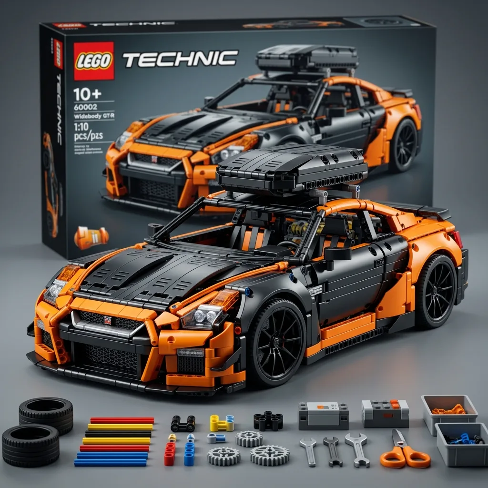

# Ultra-detailed studio product render of a LEGO Technic style

[← Back to the collection](../../README.md) · Category: [Photography](../../gallery/photography.md) · Model: `Vinano Image Pro` · ID: `vn-00385`

<a href="https://vinano.ai?utm_source=github&utm_medium=readme&utm_campaign=awesome-image-video-prompts-updating&utm_content=prompt-page-image"></a>

<sub>Preview generated with <a href="https://vinano.ai?utm_source=github&utm_medium=readme&utm_campaign=awesome-image-video-prompts-updating&utm_content=prompt-page-caption">vinano.ai</a></sub>

## Prompt

```text
Ultra-detailed studio product render of a LEGO Technic style vehicle model based precisely on the next uploaded reference photo. The LEGO build must replicate the real vehicle’s exact shape, proportions, bodylines, color scheme, headlights, grille design, wheels, and overall silhouette while constructed entirely from realistic LEGO Technic pieces and panels.
The vehicle is displayed in a clean professional product photography studio setup, placed on a smooth matte surface. Behind the car stands a large LEGO Technic product box, slightly blurred but clearly recognizable as a premium building kit package.
The vehicle features aggressive widebody styling, large sport wheels, low stance, detailed front splitter, and a roof rack cargo box built from LEGO elements, maintaining the same design style as the reference vehicle.
In front of the vehicle on the table are organized LEGO Technic components and tools, including small tires, axles, connectors, battery modules, rods, mechanical pieces, scissors, and miniature assembly tools, arranged neatly like a build kit.
Lighting is soft cinematic studio lighting subtle reflections on the LEGO plastic surfaces, ultra-sharp details, shallow depth of field, realistic shadows, premium commercial product photography style.
Composition: hero angle slightly from the front side, emphasizing the vehicle's shape and mechanical LEGO structure.
Hyper-realistic materials, crisp textures, ultra detailed LEGO plastic surface, ray-traced reflections.
8K resolution, ultra sharp, true-to-life photorealistic render, filmic, cinematic lighting, professional product shot
Aspect Ratio 9:16

Keep edges clean and the overall composition balanced for a polished, gallery-ready result.
```

## Try it on vinano.ai

1. Copy the prompt above.
2. Open **[vinano.ai](https://vinano.ai?utm_source=github&utm_medium=readme&utm_campaign=awesome-image-video-prompts-updating&utm_content=prompt-page-try)**, paste it into the image generator and pick a model.
3. Swap any placeholders (brand, product, city, person…) for your own details, then generate.

More prompts like this: [Photography gallery](../../gallery/photography.md) · [all categories](../../README.md#contents)
